<div align="center">

# dsh-zotero

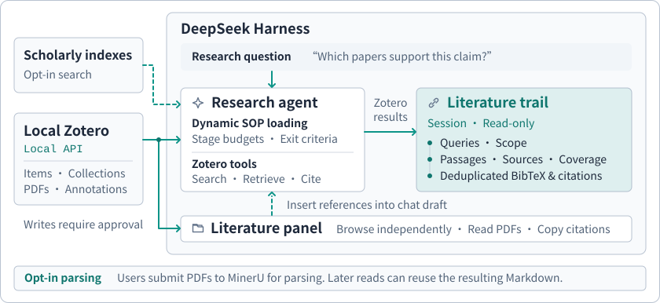
<p align="center">
  <a href="https://github.com/deepseek-ai/deepseek-harness"></a>
  <a href="https://www.npmjs.com/package/dsh-zotero"></a>
  <a href="https://www.npmjs.com/package/dsh-zotero"></a>
  <a href="https://www.npmjs.com/package/dsh-zotero"></a>
  <a href="https://github.com/deepseek-ai/deepseek-harness/releases/tag/dsh-v0.2.3-alpha.2"></a>
  <a href="https://awesome-dsh-plugin.com"></a>
  <a href="https://github.com/hashgraph-online/hol-guard"></a>
</p>
</div>

<p align="center">
  <a href="README.md"><b>中文</b></a> · <b>English</b>
</p>

<p align="center">
  <a href="#research-workflows-in-practice">Research workflows in practice</a> ·
  <a href="#features">Features</a> ·
  <a href="#quick-start">Quick start</a> ·
  <a href="#tools">Tools</a> ·
  <a href="#documentation">Documentation</a> ·
  <a href="#license">License</a>
</p>

**dsh-zotero is an AI-native research workflow plugin for DeepSeek Harness, built around your local Zotero library.** Start with a research question. The agent searches for papers, extracts passages with source locations, compares papers, and generates citations. Use the literature trail to check the search scope, passages, and skipped sources. In the literature panel, you can browse collections, read PDFs, and copy citations directly.

The agent can load research SOPs on demand for single-paper digests, evidence synthesis, manuscript reference audits, and library governance. With scholarly retrieval enabled, it can also survey a topic across indexes, trace citation networks, and verify references.

## Research workflows in practice

**Find papers for a research question.** Asked about the origins of the Transformer, the agent searches the local library and traces each paper's contribution over time using the retrieved evidence. Passages taken from abstracts are labelled as such.

| Question and search                                                                                    | Evidence and conclusion                                                                          |
| ------------------------------------------------------------------------------------------------------ | ------------------------------------------------------------------------------------------------ |
| 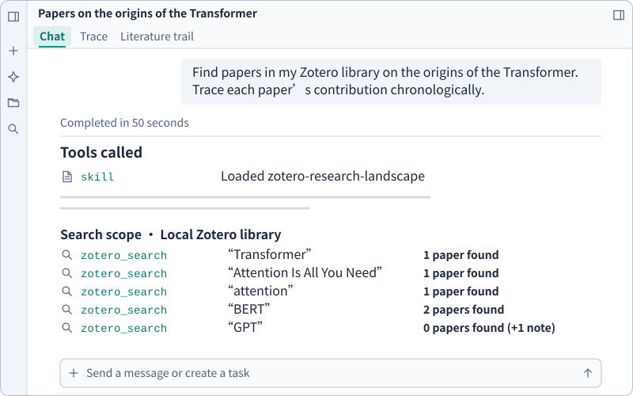 | 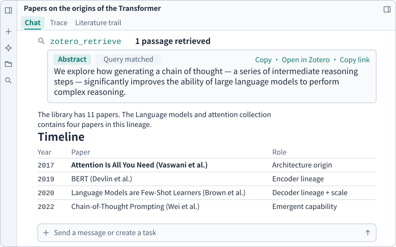 |

**Locate original passages and equations.** In a follow-up on attention, the agent retrieves definitions and equations from the PDF and cites the section and chunk where they appear. Passages from Zotero annotations keep their page labels.

| Question and provenance                                                                              | Definitions and formulas                                                                                                   |
| ---------------------------------------------------------------------------------------------------- | -------------------------------------------------------------------------------------------------------------------------- |
| 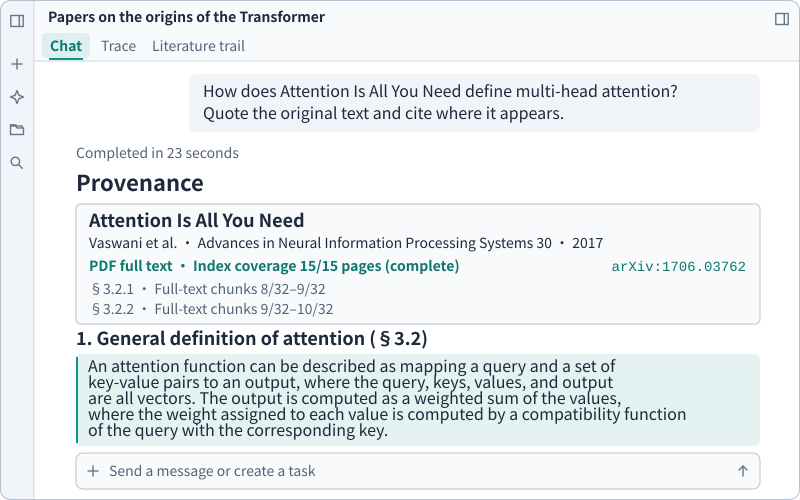 | 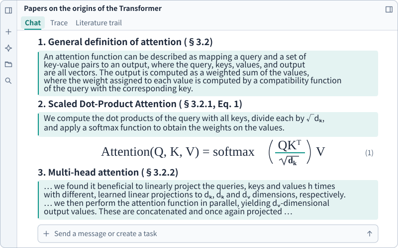 |

**Check the evidence and export citations.** Open the literature trail at the top of the session to review the passages, annotations, search origins, full-text coverage, and skipped sources. Switch to the export view to copy or download the session's deduplicated BibTeX and citations.

| Trail item inspector                                                                                            | Export summary                                                                          |
| --------------------------------------------------------------------------------------------------------------- | --------------------------------------------------------------------------------------- |
| 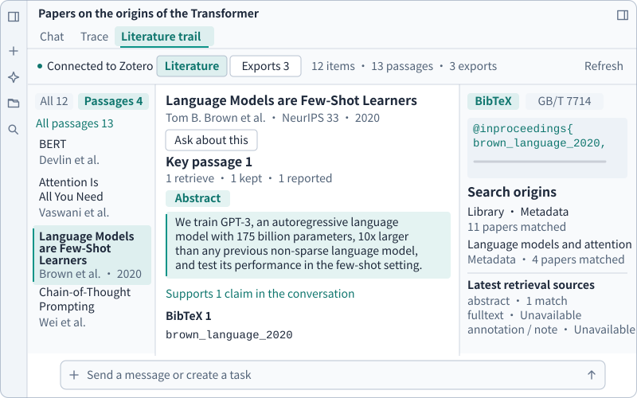 | 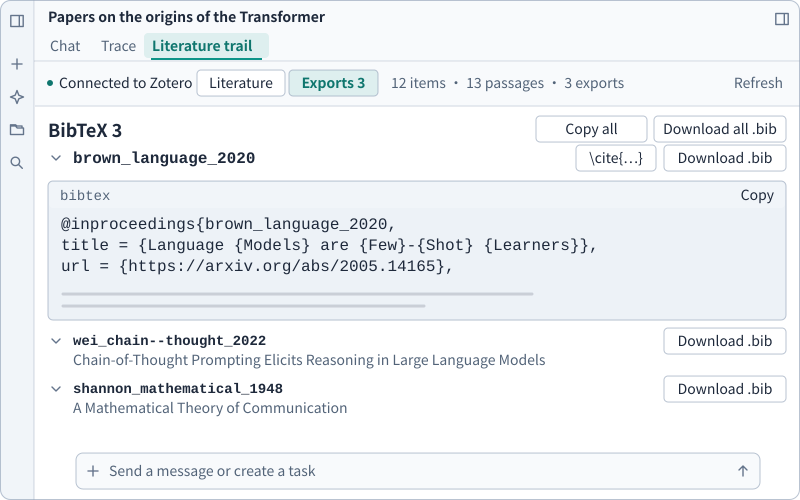 |

**Continue reading in the literature panel.** Browse Zotero collections, items, and details alongside the conversation. Open an attachment, copy a citation or BibTeX, or add a selected item to the chat draft.

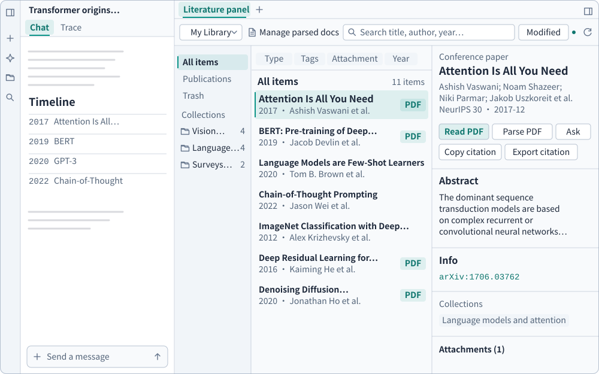

**Filter the library and open a local PDF.** Filter by title, author, or year, then open a local PDF in its own tab.

| Panel search                                                                                | PDF reading                                                                                  |
| ------------------------------------------------------------------------------------------- | -------------------------------------------------------------------------------------------- |
| 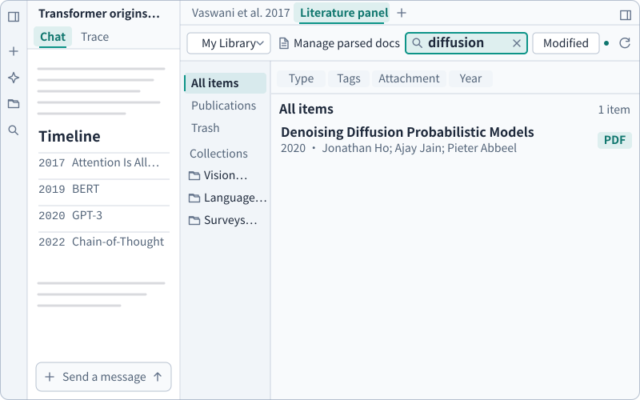 | 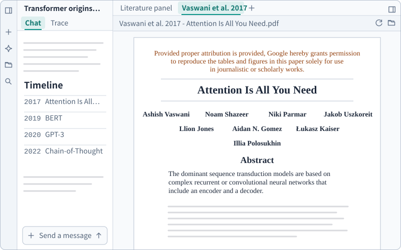 |

**Extend a search to scholarly indexes** (optional component). The agent searches arXiv, OpenAlex, Crossref, Semantic Scholar, PubMed, Europe PMC, and DBLP, merging results for the same paper by relevance. It can read open-access full text, trace citation networks, or verify references. Results report why an index did not respond. Selected papers can be saved to the personal library with approval.

| Question and tool calls                                                                         | Search parameters and results                                                                                           |
| ----------------------------------------------------------------------------------------------- | ----------------------------------------------------------------------------------------------------------------------- |
| 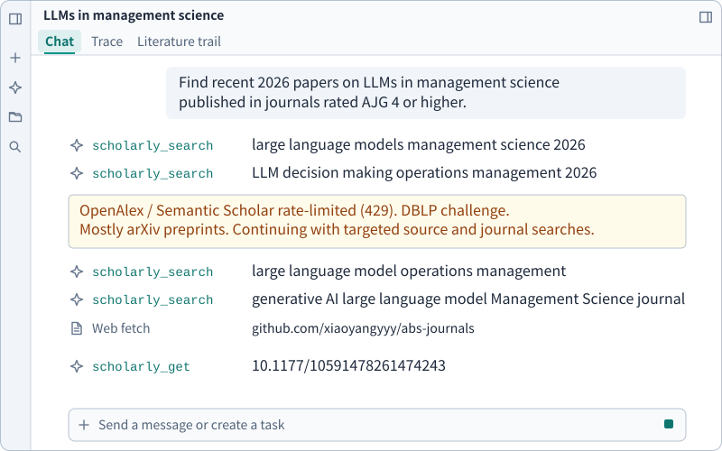 | 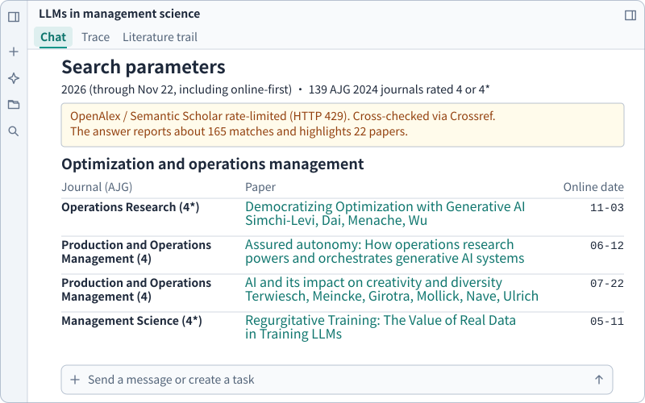 |

**Bring a parsed passage into the conversation** (optional component). Before a PDF is submitted, a confirmation card explains that the document will be sent to MinerU. Once parsing finishes, the Markdown full text is available in a tab named after the paper. Select a passage and choose "Explain" to add the passage, paper details, and a request to check the quotation into the conversation draft. Manage parsed docs supports filtering, reparsing, and batch deletion.

| Before submitting                                                                                                             | Reading Markdown                                                                                  |
| ----------------------------------------------------------------------------------------------------------------------------- | ------------------------------------------------------------------------------------------------- |
| 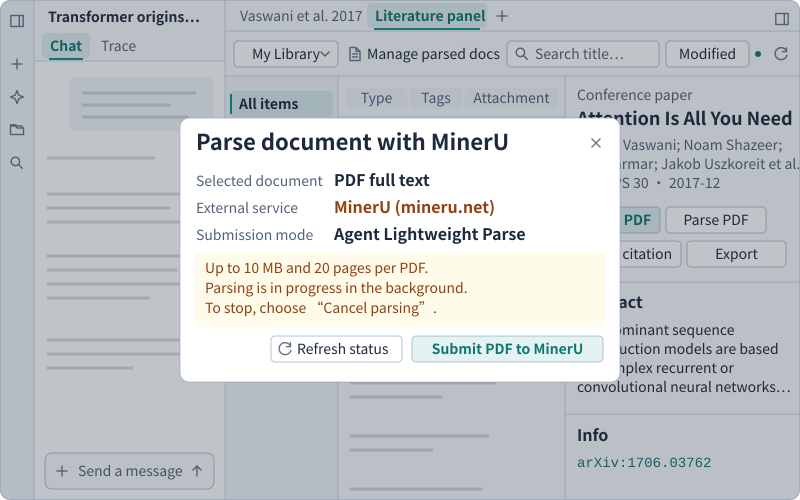 | 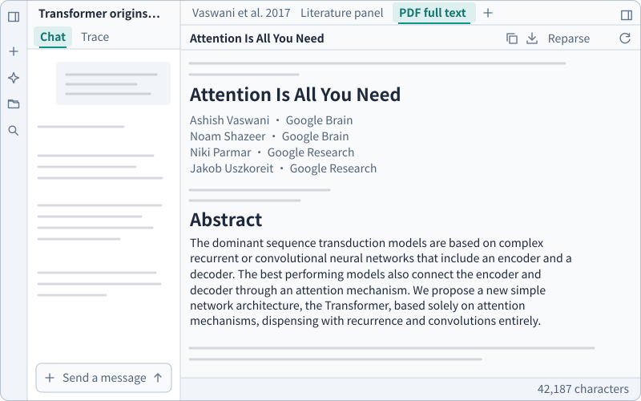 |

| Selection Q&A                                                                               | Manage parsed docs                                                                                         |
| ------------------------------------------------------------------------------------------- | ---------------------------------------------------------------------------------------------------------- |
| 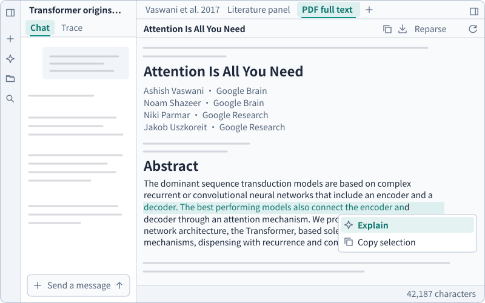 | 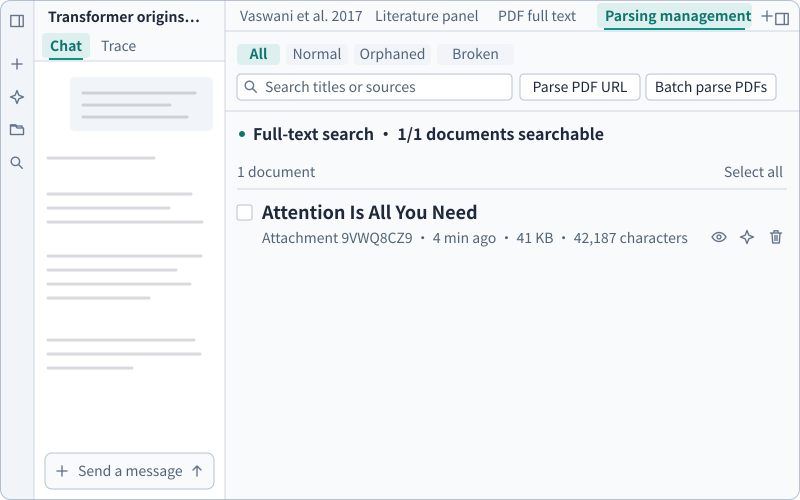 |

## Features

- **Agent research tools and SOPs**
  - **Search and browsing**: Search by title, author, year, tag, or full text, scoped to the whole library, My Publications, a collection, or a saved search. Browse collection trees, tags, and saved searches, and batch-read known refs.
  - **Passage location**: Pull passages from full text, notes, and annotations for a question, or read a whole document; passages carry their source, annotations keep Zotero page numbers, and the result reports full-text coverage and skipped sources.
  - **Citations and export**: Generate in-text citations or a merged bibliography in CSL styles, and export BibTeX, BibLaTeX, RIS, or CSL-JSON; style and locale follow the configured defaults.
  - **Reconciliation and changes**: Reconcile DOIs, BibTeX keys, or bibliographic fields against the library and get refs, citation keys, confidence, and a field diff; report additions, modifications, and deletions from the library version, with the Trash counted separately.
  - **Research SOPs**: Eight phased workflows loaded on demand, each with stage budgets and stop conditions, leaving only names and short descriptions in the prompt. The core component ships four (paper digest, evidence synthesis, manuscript audit, library governance); the scholarly component adds four (research landscape, citation lineage, publication integrity, literature intake).
- **Literature trail (session header)**
  - **Search conditions**: Every call lists its query, scope, mode (metadata or full text), filters, and hit count, with the total and note hits counted separately, so you can check the agent's scope and filters against your intent.
  - **Passage review**: Passages and annotations are grouped by item with source, page number, and coverage, so quotations in the answer can be checked against the original; refused or cancelled calls are recorded too.
  - **Export summary**: Citations and BibTeX from the session are collected across items, split by format, and deduplicated, ready to copy or download for writing; failed exports are listed separately.
- **Literature panel (right sidebar)**
  - **Browsing and filtering**: Switch libraries, expand the collection tree on demand, and open saved searches, My Publications, and the Trash. The item list searches metadata or full text, sorts by several fields, and filters by type, tag, year, and attachment presence.
  - **Details and reading**: View metadata, collections, and tags. Attachments, notes, and annotations page independently. Local PDFs open in the reading pane; with `allowUrlPdfRead`, URL attachments already in the library also open.
  - **Journal metrics**: Enable lookups in panel settings and save an EasyScholar key to see metrics such as JCR quartiles, impact factors, CAS quartiles, and Chinese core indexes. Choose list candidates and detail fields separately.
  - **Citations and handoff**: Copy a citation, bibliography, or BibTeX from the action row, and send selected items into the chat draft. The composer's Zotero button and bibliography deliverables open the panel directly.
  - **State restoration**: Per Zotero instance, the panel remembers the selected item, active section, expanded collection branches, scroll position, and child pagination.
  - **Parsed reading**: With the document parsing component enabled, the action row opens a tab named after the paper (full text, figures, selection actions); Manage parsed docs lists every artifact with filters, per-row open or reparse, and batch discard.
- **Optional capabilities (off by default)**
  - **Library writes**: Enabling `writeEnabled` registers 15 tools that write only to the personal library, covering notes, tags and collection membership, collections, items, saved searches, Trash restore, library-wide tags, and batch operations. Every write passes a capability check, session approval, and a plan-review card; an unverified commit reports "committed but unverified".
  - **Scholarly retrieval** (`dsh-zotero/scholarly`): Seven tools cover arXiv, OpenAlex, Crossref, Semantic Scholar, PubMed, Europe PMC, and DBLP, fusing and deduplicating results and marking what the library already holds. They read open-access full text, follow citation networks, fetch authoritative citations from the DOI registry, verify references and retraction status, and save results into the personal library when you ask.
  - **Document parsing** (`dsh-zotero/enrichment`): Enabling the component accepts MinerU document egress for documents you explicitly submit; a parse needs one specific Zotero PDF attachment or public PDF URL, and afterwards ordinary and scholarly full-text reads reuse the Markdown artifact with its figures.
  - **Semantic ranking** (`dsh-zotero/enrichment`): Local semantic ranking runs six CPU-only embedding tiers, fused with BM25 through RRF, and labels each passage lexical, semantic, or hybrid; the tiers can be downloaded, verified, and deleted in settings.

For details on interaction patterns, UI roles, and runtime boundaries, see the [product model](docs/product-model.en.md).

## Quick start

### Prerequisites

1. Zotero 7 or newer desktop app installed (writes require Zotero 10).
2. Enable the local API in Zotero: **Settings → Advanced → check "Allow other applications on this computer to communicate with Zotero"**.
3. Install and run a DeepSeek Harness desktop app that matches the plugin. This plugin requires dsh 0.2.3-alpha.2. If the in-app updater has not offered that version, download the installer directly and replace the version in the link as needed:
   - macOS (Apple Silicon): `https://download.deepseek.com/dsh-desk/bin/mac-arm64/deepseek-harness-0.2.3-alpha.2-mac-arm64.dmg`
   - Windows (x64): `https://download.deepseek.com/dsh-desk/bin/win-x64/deepseek-harness-0.2.3-alpha.2-win-x64.exe`

### Desktop app (Plugin Manager)

In the DeepSeek Harness desktop app, open **Plugins** in the sidebar, click **Install Plugin**, and enter the package identifier:

- Latest version (recommended): `dsh-zotero`
- Specific version: `dsh-zotero@1.5.0`
- GitHub stable prebuilt branch (latest tagged release): `github:Vncntvx/dsh-zotero#stable`
- GitHub rolling prebuilt branch (follows main): `github:Vncntvx/dsh-zotero#release`

### Command line

```sh
# Install latest from npm (recommended)
dsh plugin --profile <name> add dsh-zotero

# Install a specific version
dsh plugin --profile <name> add dsh-zotero@<version>

# Install from the GitHub stable prebuilt branch (latest tagged release)
dsh plugin --profile <name> add github:Vncntvx/dsh-zotero#stable

# Install from the GitHub rolling prebuilt branch (follows main)
dsh plugin --profile <name> add github:Vncntvx/dsh-zotero#release
```

Open the **dsh-zotero** details page in the plugin manager to adjust its settings.

> Note: installing directly from the `main` source branch needs a local `prepare` build plus an `allowBuilds` entry for `dsh-zotero` in the profile's `pnpm-workspace.yaml`; the `#stable` / `#release` branches or the npm package skip that step. The WASM runtime behind local semantic search ships inside the plugin, so nothing is installed on demand; download a model in settings — see [Getting Started](docs/getting-started.en.md).

### Your first research task

After installation, open a new conversation and replace `[research topic]` in the prompt with a topic already in your Zotero library. After the agent replies, open the **Literature trail** at the top of the session to check the search scope, passage sources, and exports.

> Find papers on [research topic] in my Zotero library, quote relevant passages with their sources, and export BibTeX.

## Tools

The plugin registers 23 local tools (8 read + 15 write) and 7 scholarly retrieval tools. Local writes are off by default, target only the personal library, and need approval each time; scholarly tools follow the `dsh-zotero/scholarly` component.

### Local read tools (8)

| Tool                      | Purpose                                                                                                   |
| ------------------------- | --------------------------------------------------------------------------------------------------------- |
| `zotero_search`           | Search papers by title, author, year, tag, or full text, with collection and tag filters                  |
| `zotero_browse`           | Browse the library structure, including the collection tree, tag list, and saved searches                 |
| `zotero_get`              | Read the metadata detail, abstract, attachments, and note list of a single paper                          |
| `zotero_get_batch`        | Read known paper refs in order and report each result independently                                       |
| `zotero_match_references` | Reconcile DOI, BibTeX, and reference fields against local items                                           |
| `zotero_retrieve`         | Find passages relevant to a question in full text, notes, and annotations (annotations keep page numbers) |
| `zotero_changes`          | Check recent additions, modifications, and deletions in the library                                       |
| `zotero_export`           | Generate formatted citations or a bibliography, or export BibTeX, RIS, or CSL JSON                        |

### Scholarly retrieval tools (7, optional component `dsh-zotero/scholarly`)

| Tool                       | Purpose                                                                                           |
| -------------------------- | ------------------------------------------------------------------------------------------------- |
| `scholarly_search`         | Search across arXiv, OpenAlex, Crossref, S2, PubMed, Europe PMC, and DBLP with RRF fusion         |
| `scholarly_get`            | Retrieve full bibliographic metadata and open-access PDF links for external papers                |
| `scholarly_citations`      | Follow forward citation and backward reference networks                                           |
| `scholarly_read`           | Open-access PDF reading and passage extraction (supports outline, section, and query modes)       |
| `scholarly_cite`           | Fetch authoritative BibTeX, RIS, or formatted citations directly from DOI registration agencies   |
| `scholarly_verify`         | Verify reference list authenticity, DOI matches, and retraction notices against Crossref          |
| `scholarly_save_to_zotero` | Save externally retrieved papers to the personal Zotero library (write operation, needs approval) |

Another 15 write tools cover notes, tags and collection membership, collections, items, saved searches, Trash restore, library-wide tags, and batch operations; see the [tool reference](docs/tools.en.md).

## Documentation

### Usage

| Document                                      | Covers                                                                                                                   |
| --------------------------------------------- | ------------------------------------------------------------------------------------------------------------------------ |
| [Getting started](docs/getting-started.en.md) | Installation, connection verification, and the first task                                                                |
| [Product model](docs/product-model.en.md)     | Two entry points, two UI surfaces, component division, and system boundaries                                             |
| [Features](docs/features.en.md)               | Conversation capabilities, the literature trail, the literature panel, writes, scholarly retrieval, and document parsing |
| [Research skills](docs/skills.en.md)          | Eight on-demand research workflows, batching budgets and evidence boundaries                                             |
| [Troubleshooting](docs/troubleshooting.en.md) | Common issues, diagnostic steps, and remedies                                                                            |

### Maintenance

| Document                                            | Covers                                                                                  |
| --------------------------------------------------- | --------------------------------------------------------------------------------------- |
| [Architecture](docs/architecture.en.md)             | Data flow, layer responsibilities, component boundaries, and design boundaries          |
| [Tool reference](docs/tools.en.md)                  | Parameters, return values, and error codes for the 23 local tools and 7 scholarly tools |
| [Configuration reference](docs/configuration.en.md) | Fields, defaults, and hot-reload behavior of each settings namespace                    |
| [Development guide](docs/development.en.md)         | Build, test, debug, and release workflow                                                |

## License

This project is released under the [MIT License](./LICENSE). The bundled onnxruntime Web runtime is MIT-licensed (`assets/onnxruntime/LICENSE`); semantic models download from Hugging Face or its mirror on demand, under the terms on each model page.
