<div align="center">

# dsh-zotero

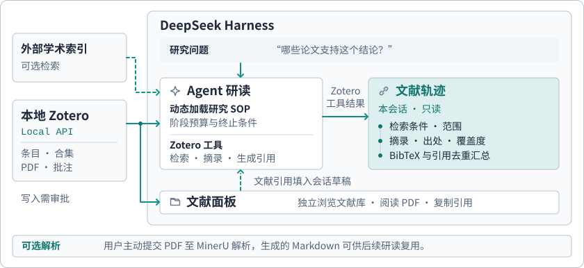
<p align="center">
  <a href="https://github.com/deepseek-ai/deepseek-harness"></a>
  <a href="https://www.npmjs.com/package/dsh-zotero"></a>
  <a href="https://www.npmjs.com/package/dsh-zotero"></a>
  <a href="https://www.npmjs.com/package/dsh-zotero"></a>
  <a href="https://github.com/deepseek-ai/deepseek-harness/releases/tag/dsh-v0.2.3-alpha.2"></a>
  <a href="https://awesome-dsh-plugin.com"></a>
  <a href="https://github.com/hashgraph-online/hol-guard"></a>
</p>
</div>

<p align="center">
  <a href="README.en.md"><b>English</b></a> · <b>中文</b>
</p>

<p align="center">
  <a href="#科研工作流示例">科研工作流示例</a> ·
  <a href="#主要功能">主要功能</a> ·
  <a href="#快速开始">快速开始</a> ·
  <a href="#工具一览">工具一览</a> ·
  <a href="#说明文档">说明文档</a> ·
  <a href="#许可证">许可证</a>
</p>

**dsh-zotero 是一款以本地 Zotero 文献库为基础的 AI 原生科研工作流插件，运行于 DeepSeek Harness。** 从研究问题出发，Agent 检索文献、提取有出处的证据、比较论文并生成引用。你可以在文献轨迹中核对检索范围、原文摘录与被跳过的来源，也可以在文献面板中浏览合集、阅读 PDF 和复制引用。

Agent 根据任务动态加载研究 SOP，完成单篇速读、证据比较、写作对账与文库治理。启用学术检索后，还可以在多个学术索引间梳理主题版图、追踪引文脉络和核验文献。

## 科研工作流示例

**围绕研究问题发现文献**：以 Transformer 架构起源为例，Agent 在本地库检索相关论文，并结合检索到的证据梳理各篇贡献与时间线。来自摘要的片段标注为「摘要」。

| 提问与检索过程                                                                       | 依据与结论                                                                  |
| ------------------------------------------------------------------------------------ | --------------------------------------------------------------------------- |
| 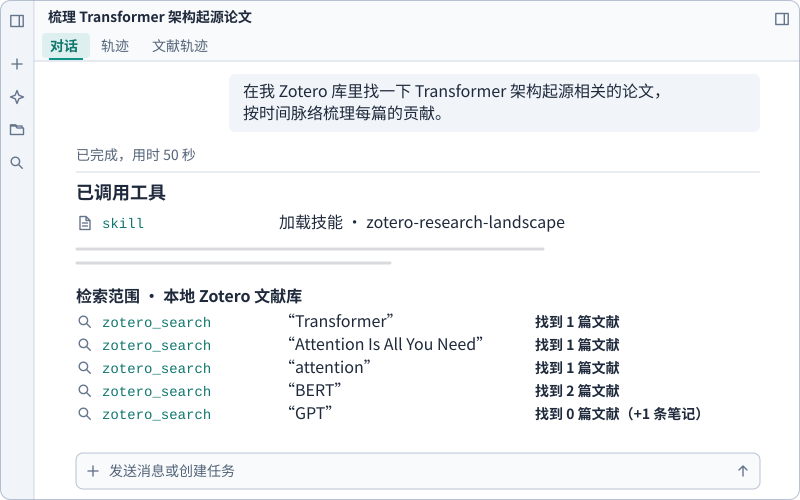 | 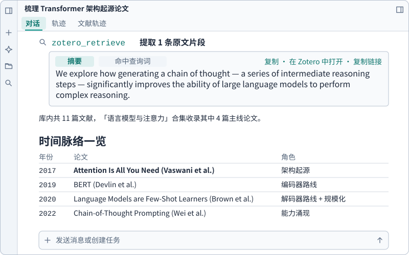 |

**定位原文与公式**：追问注意力机制时，Agent 从 PDF 全文定位定义与公式，注明章节号与全文分块位置。来自 Zotero 批注的片段保留页码标签。

| 提问与出处                                                                       | 原文定义与公式                                                                     |
| -------------------------------------------------------------------------------- | ---------------------------------------------------------------------------------- |
| 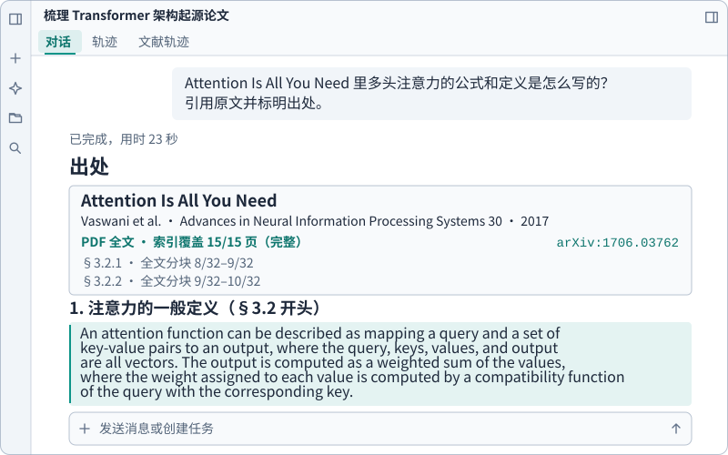 | 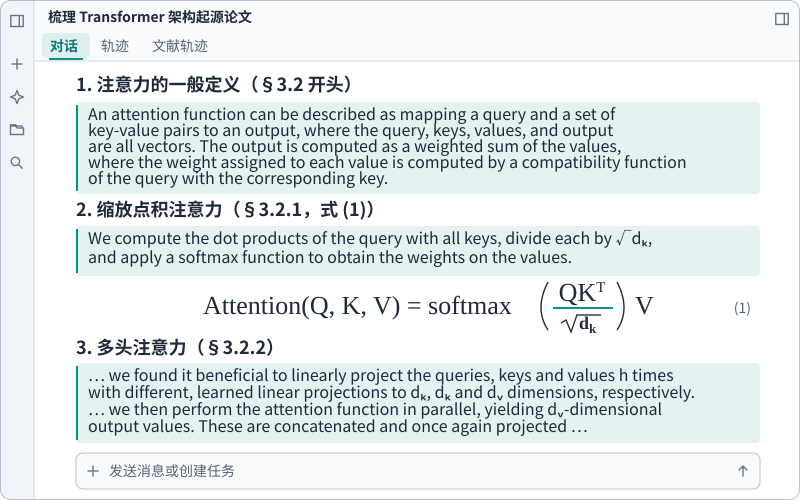 |

**核对证据并导出引用**：在会话顶部打开文献轨迹，可按条目检查 Agent 摘取的片段、批注和检索来源，以及全文覆盖度和被跳过的来源。导出视图按格式汇总本会话的 BibTeX 与引用，提供去重结果的复制与下载入口。

| 文献轨迹条目检查                                                                    | 导出汇总                                                                |
| ----------------------------------------------------------------------------------- | ----------------------------------------------------------------------- |
| 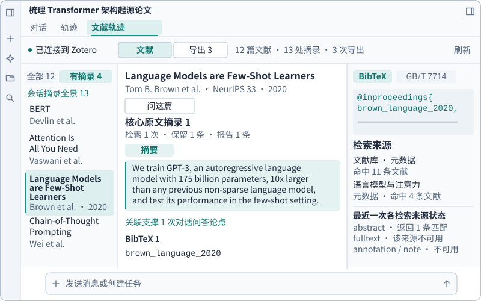 | 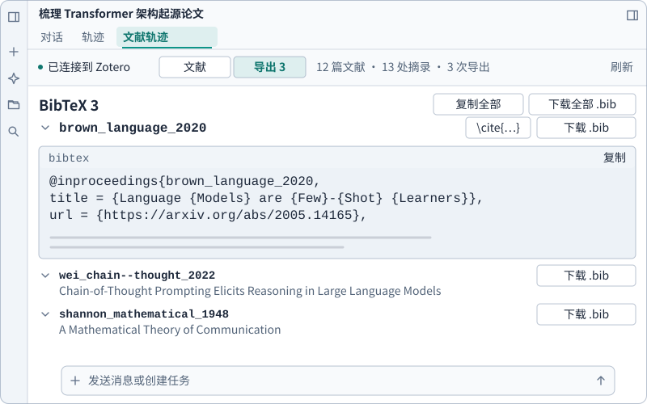 |

**通过文献面板接续研读**：在对话旁浏览 Zotero 合集、条目和详情，可自行阅读附件、复制引用或 BibTeX，也可将选中条目的引用填入会话草稿。

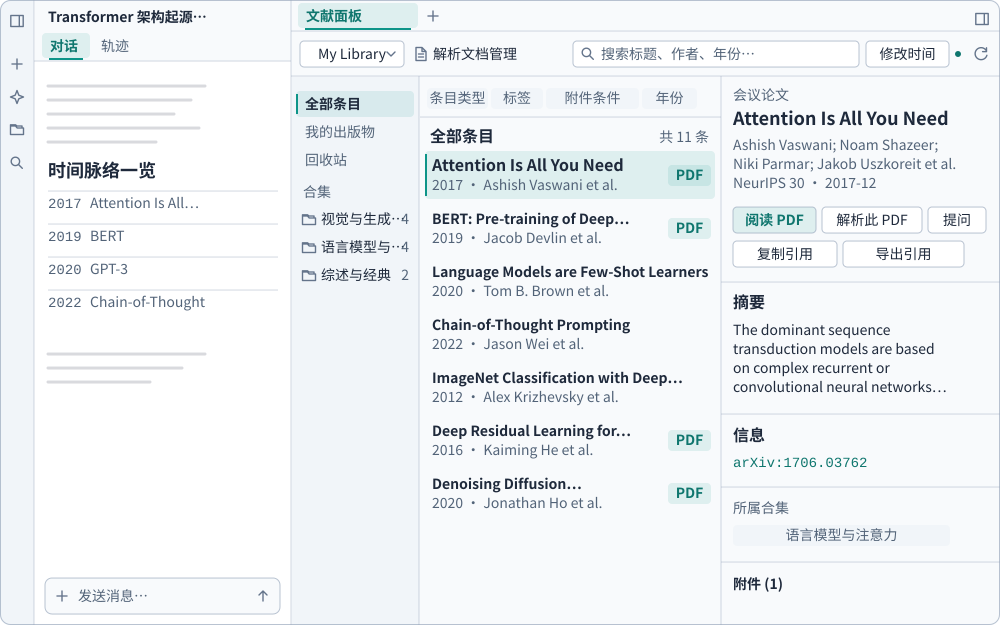

**筛选本地文献并打开 PDF**：按标题、作者或年份筛选条目，在独立标签页打开本地 PDF。

| 面板内检索                                                                          | PDF 阅读                                                                                      |
| ----------------------------------------------------------------------------------- | --------------------------------------------------------------------------------------------- |
| 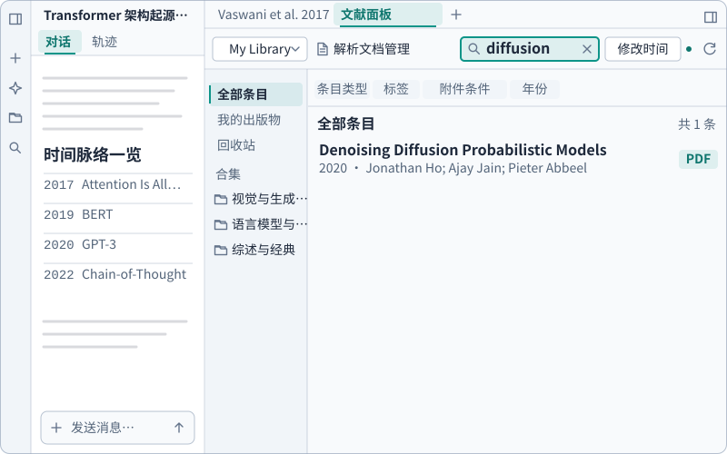 | 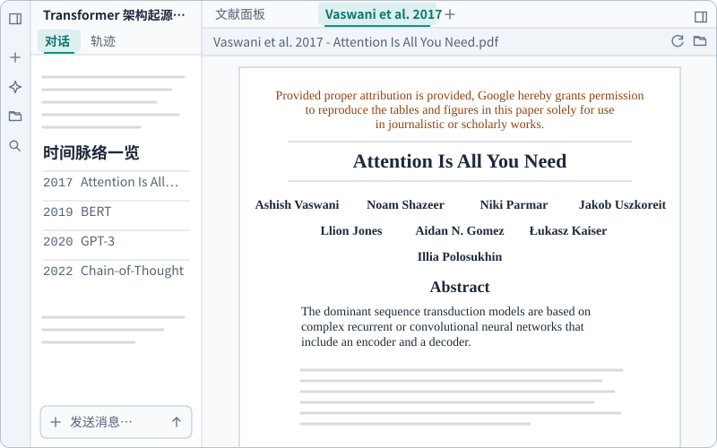 |

**把检索扩展到外部学术索引**（可选组件）：Agent 跨 arXiv、OpenAlex、Crossref、Semantic Scholar、PubMed、Europe PMC 与 DBLP 查找相关论文，并按相关度融合同一论文的结果；可继续读取开放获取全文、追踪引用网络或核验参考文献。未应答的索引会在结果中列出原因。选中的结果经审批后可保存到个人库。

| 提问与工具调用                                                                | 检索口径与结果                                                                         |
| ----------------------------------------------------------------------------- | -------------------------------------------------------------------------------------- |
| 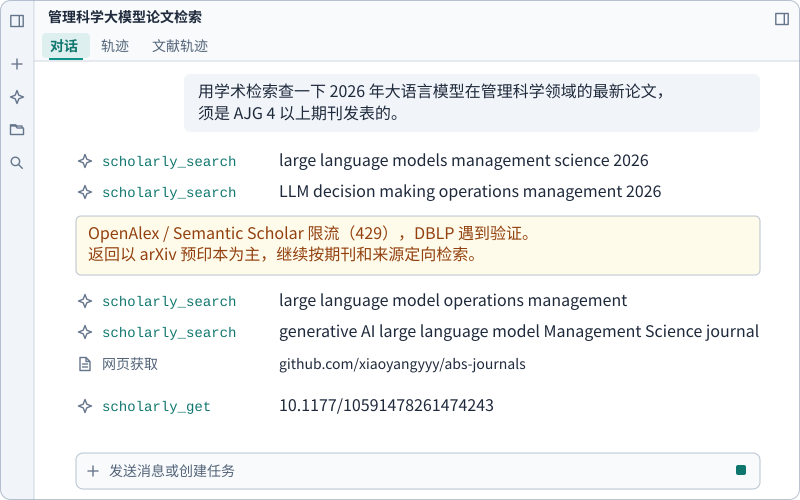 |  |

**把解析后的原文带回研究对话**（可选组件）：提交 PDF 前，确认卡说明文档将发送至 MinerU。解析完成后，可在以论文标题命名的标签页阅读 Markdown 全文。选中段落后点击「让模型解释」，选段、论文信息与核对引文的要求一并写入会话草稿。「解析文档管理」汇总全部产物，支持筛选、重新解析与批量删除。

| 提交解析前                                                                                | 阅读 Markdown                                                              |
| ----------------------------------------------------------------------------------------- | -------------------------------------------------------------------------- |
| 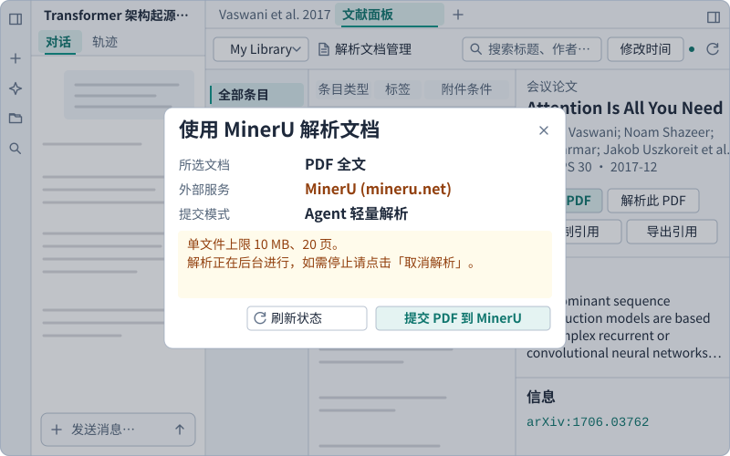 |  |

| 选中提问                                                                     | 解析文档管理                                                                          |
| ---------------------------------------------------------------------------- | ------------------------------------------------------------------------------------- |
| 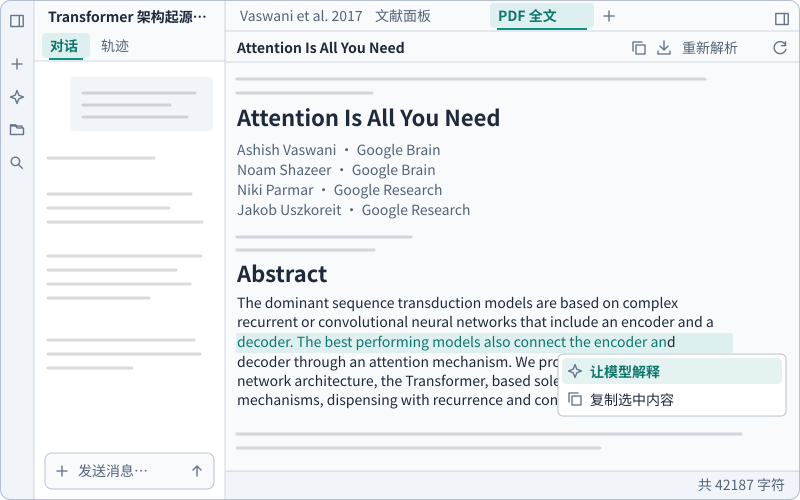 | 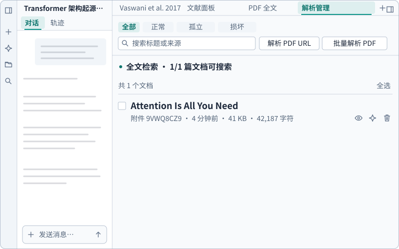 |

## 主要功能

- **Agent 研究工具与 SOP**
  - **检索浏览**：按标题、作者、年份、标签或全文检索，范围可为全库、我的出版物、合集或保存搜索；合集树、标签与保存搜索可直接浏览，已知 ref 可批量读取。
  - **原文定位**：围绕问题从全文、笔记与批注中取回片段，也能通读整篇文献；片段标注来源，批注保留 Zotero 页码，并报告全文覆盖度与被跳过的来源。
  - **引用与导出**：按 CSL 样式生成行内引用或合并参考文献表，导出 BibTeX、BibLaTeX、RIS 与 CSL-JSON；样式与语言沿用配置默认值。
  - **对账与变更**：用 DOI、BibTeX 键或文献字段与本地库对账，返回 ref、citekey、置信度与字段差异；按库版本号报告新增、修改与删除，回收站单列。
  - **研究 SOP**：八个分阶段流程，根据任务动态加载，各自定义阶段预算与终止条件，常驻提示词只保留名称与短描述。核心组件提供四个（单篇速读、证据比较、写作对账、文库治理），学术检索组件另加四个（主题版图、引文脉络、真伪审查、文献入库）。
- **文献轨迹（会话顶部）**
  - **检索条件**：逐次列出查询词、范围、模式（元数据或全文）、筛选与命中数，总数与笔记命中分开计，可核对 Agent 的检索范围与条件是否符合预期。
  - **原文核对**：按条目聚合读过的片段与批注，带来源、页码与覆盖度，回答里的引述可逐条对回原文；被拒绝或取消的调用同样记录。
  - **导出汇总**：跨条目汇总本轮会话的引用与 BibTeX，按格式分段、去重，可复制或下载，直接用于写作；失败的导出单独列出。
- **文献面板（右侧边栏）**
  - **浏览筛选**：多库切换、按需展开的合集树、保存搜索、我的出版物与回收站；条目列表支持元数据或全文检索、多种排序，可按类型、标签、年份与附件筛选。
  - **详情阅读**：可查看元数据、合集与标签。附件、笔记和批注分别分页。启用科研阅读器后，本地 PDF 在阅读标签页打开；未启用时使用原生预览。开启 `allowUrlPdfRead` 后可读取库内已有的 URL 附件。
  - **期刊指标**：可在面板设置中启用并保存 EasyScholar 密钥，查询 JCR 分区、影响因子、中科院分区和中文核心等指标，分别配置列表候选和详情字段。
  - **引用联动**：动作行可复制引用、参考文献表或 BibTeX。选中条目的引用可填入会话草稿。输入框的 Zotero 按钮与书目交付物直接打开面板。
  - **状态恢复**：按 Zotero 实例记住选中条目、当前分段、展开的合集分支、滚动位置与子条目分页。
  - **解析阅读**：启用文档解析组件后，动作行可打开以论文标题命名的解析标签页（全文、插图、选段解释）；「解析文档管理」列出全部产物，支持筛选、逐行打开或重新解析、批量删除。
- **可选能力（默认关闭）**
  - **文献写入**：开启 `writeEnabled` 后注册 15 个工具，仅写个人库，覆盖笔记、标签与合集归属、合集、条目、保存搜索、Trash 恢复、全库标签与批量操作；每次写入经过能力检查、会话审批与计划审查卡，未核验的提交显示「已提交未确认」。
  - **学术检索**（`dsh-zotero/scholarly`）：7 个工具覆盖 arXiv、OpenAlex、Crossref、Semantic Scholar、PubMed、Europe PMC 与 DBLP，结果融合去重并标出「已在本地库」；可读开放获取全文、追踪引文网络、获取权威引用、核验参考文献与撤稿状态，在你明确要求时保存入库。
  - **文档解析**（`dsh-zotero/enrichment`）：启用即表示接受向 MinerU 外发你主动提交的文档；解析需显式指定一个 Zotero PDF 附件或公开 PDF URL，成功后普通检索与学术全文精读复用 Markdown 产物并保留插图。
  - **语义排序**（`dsh-zotero/enrichment`）：本地语义排序在 CPU 上运行六档嵌入模型，结果与 BM25 经 RRF 融合，片段标注词法、语义或混合命中；模型可在设置中下载、校验与删除。
  - **科研阅读器**（`dsh-zotero/reader`）：在右侧标签页打开本地 PDF、网页快照、Markdown、纯文本和 Zotero 笔记，显示并编辑原生标注与笔记，支持选区翻译、区域截图、引用与证据定位；原生写入仍经会话审批与计划审查。

交互方式、界面分工与运行边界详见[产品模型](docs/product-model.md)。

## 快速开始

### 前置条件

1. 安装并运行 Zotero 7 及以上桌面版（写入功能需 Zotero 10）。
2. 在 Zotero 中开启本地 API：**设置 → 高级 → 勾选“允许此计算机上的其他应用程序与 Zotero 通信”**。
3. 安装并运行与插件匹配的 DeepSeek Harness 桌面端。当前插件要求 dsh 0.2.3-alpha.2；如果应用内更新尚未提供该版本，可直接下载安装包（将链接中的版本替换为所需版本）：
   - macOS（Apple Silicon）：`https://download.deepseek.com/dsh-desk/bin/mac-arm64/deepseek-harness-0.2.3-alpha.2-mac-arm64.dmg`
   - Windows（x64）：`https://download.deepseek.com/dsh-desk/bin/win-x64/deepseek-harness-0.2.3-alpha.2-win-x64.exe`

### 桌面端安装（插件管理器）

在 DeepSeek Harness 桌面端打开侧栏的**插件**，点击**安装插件**，输入对应标识：

- 最新版（推荐）：`dsh-zotero`
- 指定版本：`dsh-zotero@1.5.0`
- GitHub 稳定版预构建分支（最近一次 tag 发布）：`github:Vncntvx/dsh-zotero#stable`
- GitHub 滚动预构建分支（跟随 main）：`github:Vncntvx/dsh-zotero#release`

### 命令行安装

```sh
# npm 安装最新版（推荐）
dsh plugin --profile <name> add dsh-zotero

# 安装指定版本
dsh plugin --profile <name> add dsh-zotero@<version>

# 从 GitHub 稳定版预构建分支安装（最近一次 tag 发布）
dsh plugin --profile <name> add github:Vncntvx/dsh-zotero#stable

# 从 GitHub 滚动预构建分支安装（跟随 main）
dsh plugin --profile <name> add github:Vncntvx/dsh-zotero#release
```

在插件管理器中打开 **dsh-zotero** 详情页可调整插件配置。

> 提示：从 `main` 源码分支直接安装需要本地执行 `prepare` 构建，并在 profile 的 `pnpm-workspace.yaml` 中允许 `dsh-zotero` 的构建脚本；改用 `#stable` / `#release` 分支或 npm 包可免除这一步。本地语义检索的 WASM 运行时随插件发布，无需另行安装；模型在设置中下载，详见[快速入门](docs/getting-started.md)。

### 第一次研读

安装后新建会话。用 Zotero 库里已有的主题替换提示词里的「研究主题」。收到回答后，打开会话顶部的**文献轨迹**，核对检索范围、摘录来源与导出结果。

> 在我的 Zotero 库里找关于〈研究主题〉的论文，摘录相关段落并标明出处，再导出 BibTeX。

## 工具一览

插件注册 23 个本地工具（8 个读工具 + 15 个写工具）与 7 个学术检索工具。本地写入默认关闭、仅写个人库、每次写入需审批；学术检索工具随 `dsh-zotero/scholarly` 组件启用。

### 本地读取工具（8 个）

| 工具                      | 用途                                                         |
| ------------------------- | ------------------------------------------------------------ |
| `zotero_search`           | 按标题、作者、年份、标签或全文搜索文献，支持按分类与标签筛选 |
| `zotero_browse`           | 浏览文献库结构，包括分类合集树、标签列表和保存的搜索         |
| `zotero_get`              | 读取单篇文献的元数据详情、摘要、附件与笔记列表               |
| `zotero_get_batch`        | 按顺序批量读取已知文献 ref，逐条报告结果                     |
| `zotero_match_references` | 将 DOI/BibTeX/文献字段与本地条目对账                         |
| `zotero_retrieve`         | 围绕问题从全文、笔记与批注中检索相关段落（批注保留页码）     |
| `zotero_changes`          | 检查文献库最近的新增、修改或删除记录                         |
| `zotero_export`           | 生成格式化引用、参考文献列表，或导出 BibTeX、RIS、CSL JSON   |

### 学术检索工具（7 个，可选组件 `dsh-zotero/scholarly`）

| 工具                       | 用途                                                                      |
| -------------------------- | ------------------------------------------------------------------------- |
| `scholarly_search`         | 跨 arXiv、OpenAlex、Crossref、S2、PubMed、Europe PMC、DBLP 检索并融合去重 |
| `scholarly_get`            | 获取外部文献元数据详情与开放获取全文直链                                  |
| `scholarly_citations`      | 追踪论文的引用与被引网络                                                  |
| `scholarly_read`           | 开放获取 PDF 全文精读与段落证据提取（支持 outline/section/query）         |
| `scholarly_cite`           | 从 DOI 注册中心获取权威 BibTeX、RIS 与格式化引用                          |
| `scholarly_verify`         | 对照 Crossref 官方数据库核验参考文献真实性与撤稿状态                      |
| `scholarly_save_to_zotero` | 将外部检索到的文献保存至本地 Zotero 个人库（写操作，需审批）              |

另有 15 个写入工具，覆盖笔记、标签与合集归属、合集、条目、保存搜索、Trash 恢复、全库标签与批量操作，见[工具参考](docs/tools.md)。

## 说明文档

### 使用

| 文档                                | 内容                                                   |
| ----------------------------------- | ------------------------------------------------------ |
| [快速入门](docs/getting-started.md) | 安装、连接验证与第一个任务                             |
| [产品模型](docs/product-model.md)   | 两个入口、两大视图、组件分工与系统边界                 |
| [功能概览](docs/features.md)        | 对话能力、文献轨迹、文献面板、写入、学术检索与文档解析 |
| [研究技能](docs/skills.md)          | 八个按需研究流程、批处理预算与证据边界                 |
| [故障排查](docs/troubleshooting.md) | 常见问题、诊断步骤与处理方法                           |

### 维护

| 文档                              | 内容                                               |
| --------------------------------- | -------------------------------------------------- |
| [系统架构](docs/architecture.md)  | 数据流、分层职责、组件边界与设计边界               |
| [工具参考](docs/tools.md)         | 23 个本地工具与 7 个学术工具的参数、返回值与错误码 |
| [配置参考](docs/configuration.md) | 各设置命名空间的字段、默认值与热更新机制           |
| [开发指南](docs/development.md)   | 构建、测试、调试与发布流程                         |

## 许可证

本项目遵循 [MIT 许可证](./LICENSE)。内置的 onnxruntime Web 运行时为 MIT 许可（`assets/onnxruntime/LICENSE`）；语义模型在设置中按需从 Hugging Face 或其镜像下载，具体许可见各模型页面。
