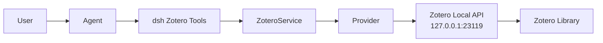

<a href="architecture.md"><b>中文</b></a>

# Architecture

## Overview

dsh-zotero is a Cordis service plugin exposing the `ctx.zotero` service boundary. The loader mounts the default `ZoteroService` export alongside its validated configuration.

## Data Flow

## Core Layers

### Service Layer (`src/service.ts`)

- `ZoteroService` extends Cordis `Service`, registered as `ctx.zotero`;
- Orchestrates providers, capability gates, and unified domain entrypoints;
- Treats the Loader entry as authoritative; settings commits apply via `loader/volatile-update` to the same entry;
- Structural configuration updates rebuild the HTTP client, provider, and write tools on the active instance: the six keys in `TRANSPORT_CONFIG_KEYS` (`baseUrl`, `timeoutMs`, `maxResponseBytes`, `maxInFlightRequests`, `writeAuthorizeDeadlineMs`, `writeEnabled`). Every other limit is read live through the provider and does not rebuild;
- Write gates converge at the service boundary: all write calls receive a `ZoteroWriteCall` and must clear capability checks, session approval policy (`ctx.approval.request`), and plan review cards;
- Listens on `tools/pre-execute` to detect shell commands targeting the local API and escalate them to Harness approval requests;
- Request-driven architecture: plugin startup never issues background network requests.

### Provider Layer (`src/local/provider.ts`)

- `LocalApiProvider` implements the `ZoteroProvider` interface;
- Exposes search, metadata, attachments, citation, browse, retrieve, and changes capabilities; write capabilities require explicit configuration and authorization;
- Resolves search and browse scope names from its own cached scope listings; the scope directory holds those listings and rebuilds its caches with the transport; the `trash` scope (the `/items/trash` listing) is a library-panel-only search scope that the model tool input schemas omit;
- Bounded concurrency on fan-out reads (`searchConcurrency`, `graphConcurrency`) keeps one call from flooding the local API;
- Note content scans execute within configured record limits on the initial page (offset 0);
- Retrieved passages rank via the BM25 term frequency algorithm;
- Export operations stay inside the local API's batch limits: the five non-`citation` formats (`bibliography`, `bibtex`, `biblatex`, `ris`, `csljson`) each fetch their items in one request (up to 50 keys per `itemKey` request) and never refetch an item alone, and are refused above 50. `ris` and `csljson` need only that call; `bibtex` and `biblatex` also fire one metadata batch in parallel (`fetchRawItemBatch`) to align the export back to each item; `citation` is the only batching format, sending 50-key requests one after another;
- Write domain supports cross-library relations (`dc:relation`), automatically mapping group library items to canonical `http://zotero.org/groups/<id>/items/<key>` URIs.

### Background Job Engine (`src/job-runner.ts`)

- Integrates with Harness's `ctx.jobs` task subsystem;
- Supports explicit background execution (`run_in_background: true`) and automatic timeout promotion (`promoteOnTimeout: true`, governed by `foregroundWaitMs`);
- Signal decoupling: background jobs run under independent `AbortController` signals, so a turn timeout or a client cancellation leaves an active background job running;
- Channel isolation: progress updates stream through `{ channel: 'log' }` to the session header and log stream without polluting model context; completed payloads write to `JobOutcome.result`;
- On-demand lifecycle: no persistent daemon polling processes.

### HTTP Transport Layer (`src/http-client.ts`)

- Restricts network calls to loopback HTTP, pinning the API version to 3;
- Verifies instance identity using the `Zotero-Server-ID` header;
- Enforces streaming response body size limits (`maxResponseBytes`);
- Enforces a process-wide in-flight request bound (`maxInFlightRequests`, default 8), managing concurrency slots across all tools;
- Follows no redirects and uses no persistent connections;
- Coordinates timeouts through a fused deadline and the caller's cancellation signal.

### Passage Retrieval Pipeline (`src/evidence.ts`)

- Tokenization: uses `Intl.Segmenter` (CJK-aware) with folding aligned to Zotero's `normalizeForSearch`; folding applies only to matching, preserving verbatim text in output;
- BM25 ranking parameters: k1=1.2, b=0.75;
- Document frequency evaluates against the item's own passage corpus;
- Excludes zero-scoring passages: a passage that shares no term with the query is not considered relevant, so a query with no overlap returns an empty list rather than arbitrary excerpts.

### Scholarly Literature Subsystem (`src/scholarly/`, optional component)

`dsh-zotero/scholarly` is a separate bundle component that ships with the bundle but is disabled by default (its row carries `disabled: true` in `cordis.patch.yml`). **Whether the component is mounted is the only authorization**: mounting it registers the seven retrieval tools and the component's own prompt section, and permits requests to the allowlisted external indexes; while it is not mounted, its service, its transport, and its tools do not exist, so the host cannot make an external request at all. The row in the plugin manager's "Included components" list and `disabled: false` in the active profile's `cordis.patch.yml` are the same path. It is isolated from the local Zotero path: every request goes to an external index, and its only crossing with `ctx.zotero` is the read-only "is this paper already held" annotation.

- **Authorization and prompt share one source**: the policy the model reads about these tools is registered by the component itself (`src/scholarly/prompt.ts`, section name `scholarly:policy`), so it appears when the component mounts and disappears when it unmounts. The parent component's Zotero policy names no external tool, because it cannot know whether the child component exists. The capabilities the prompt names and the tools that are registered always agree.

- **Host allowlist**: `src/scholarly/transport/hosts.ts` is the single source: both the accepted host set and the per-host pacing interval derive from `SCHOLARLY_HOSTS`. An allowlist entry without a pacing entry leaves a busy index unthrottled, and a paced host the adapter never calls throttles nothing; a host that wants to be fetched must be added to this table.
- **Transport**: deadlines come from `@deepseek-ai/dsh-timeout`'s `deadline()` / `timeoutOf()`, so a provider timeout and a caller abort stay distinguishable (the latter is never retried); the response ceiling comes from the shared `src/transport-bounds.ts` — one implementation and one 16 MiB bound for both transports; in-flight requests are bounded by `ConcurrencyGate`.
- **Credentials**: of the three `role('secret')` keys, Semantic Scholar and OpenAlex travel in headers (`x-api-key` / `Authorization: Bearer`); NCBI E-utilities accept `api_key` only as a query parameter, so that key does cross the URL and the transport absorbs the cost — `ScholarlyHttpError` carries the host only, and rejection messages name the hostname, never the full URL.
- **Full-text cache**: `src/scholarly/fulltext/store.ts` keeps one JSON document per key under `dshCachePath('zotero-scholarly')` and only eight index entries in memory. It does not use `ctx.storageDomain`: that seam's `KvTable.get()` is a synchronous read of a fully resident table, and one paper body reaches 200 KB. Reads have three outcomes (`hit` / `miss` / `corrupt`); a corrupt entry is evicted and recorded, never reported as absent.
- **Failure semantics**: each full-text route records why it failed and the terminal error lists them (`Tried: …`); `scholarly_verify` reports four verdicts (`verified` / `check` / `not_found` / `unverified`) so "the registry answered and holds no such work" stays distinct from "the registry could not be reached" — reporting the second as the first makes a user delete a correct citation.
- **Public surface**: `src/scholarly/index.ts` exports only the service class, the config schema, and the domain types; the transport, host table, store, and fusion internals are not exported.

### Independent Library Subcomponent (`src/library/`, `dsh-zotero/library`)

`dsh-zotero/library` is an independently declared DSH bundle subcomponent, shipped with the bundle and enabled by default (`cordis.patch.yml` includes its row). Whole-library browsing, search, detail inspection, and right-sidebar mounting live in this component:

- **Service boundary**: an independent Cordis service `ctx.zoteroLibrary` (`ZoteroLibraryService`, derived from `TypertRemoteService`) owns the `zoteroLibrary` service key and the `library` settings namespace (the `cordis.patch.yml` row id). Read requests (`browse` / `search` / `item`) forward to the host `ctx.zotero` service; write requests go through `executeLibraryWrite` into the standard write approval chain, the same as the other write tools: capability gate and `ctx.approval.request` session approval;
- **Configuration**: the schema lives in `src/library/config.ts` (`LibraryConfigSchema`) with the `rightSidebarEnabled` toggle, `volatile`. With `webEnabled: false` the library does not mount;
- **Exports**: `package.json` publishes `./library`, `./library/locale/*.json`, and `./library/icon`, separate from the root export.

### Browser Client (`src/client/`)

- Bundle Configuration (`plugins.bundle.config` and `plugins.row.config`): registers a unified 6-tab configuration interface on the Plugin Manager detail page (General, Connection, Search & Extraction, Library, Scholarly Search, Advanced), managing the `zotero`, `library`, and `scholarly` namespaces through the harness `SettingsForm` and `SettingsFormModel`, with dual-channel presentation and staged drafts kept across views; also provides a sidebar toggle form via `plugins.row.config` on `dsh-zotero#library`, guarded by `whileServed('library')`;
- Library panel:
  - **Right tab (`sidebarRightTabs` + `sidebar.right.pane.tab` + `sidebar.right.pane.tab.title`)**: controlled by `rightSidebarEnabled`; `sidebar.right.pane.tab` is session-scoped — the panel binds to the conversation its tab belongs to, and file reads and write approvals anchor to that session;
  - **Container query layout**: the wide layout switches at the anonymous container query `@container (min-width: 720px)`; a segmented navigation bar (`Navigation / List / Inspector`) on narrow widths, three columns on wide ones;
- Session Panel (`conversation.view`): the conversation tab shows one Zotero panel, with a top lens bar switching between the sources workspace and the session-wide exports page. Each source's inspector holds an Overview panel, a Passages panel for retrieved passages, and an Exports panel for that item's exported documents;
- Tool Cards (`tool.call.toolview`): one compact, collapsible card for each of the 23 local model tools (8 read and 15 write) and one for `scholarly_save_to_zotero`; the other six Scholarly retrieval tools use the generic row the slot contract defines for an unclaimed key. Cards carry copy actions on the values worth copying, sidebar PDF reading through the "Read PDF" action, and copy-to-locate actions for titles and canonical deep links. A card renders output the tool already produced and never calls the tool itself;
- Command Status Card (`conversation.chat.commandview`): renders connectivity status, the version and Server ID details, diagnosis tips, and an in-place refresh button for `/zotero`. Structured facts come from the `zoteroStatus` session projection the host half registers: the command handler projects the same status into a `zotero/status` session event and points at it with `sourceEventSeq`, the card reads it back through `useProjection`, and the command text remains a human-readable answer that is never parsed. An in-place refresh's live probe outranks the projection, being the newer answer;
- `webEnabled` takes effect immediately upon saving.

#### Tool Argument Access and Dual Error Boundaries

- **Argument access**: Tool cards and the Sources reducer read `block.args` through `argsViewOf(block)` in `src/client/presenters.ts`; the upstream dsh 0.2.1-rc.3 contract guarantees a non-optional `ToolArgs` (`PartialArguments`) on every call head and result.
- **Dual error boundaries**: The plugin registers two error boundaries:
  - **Surface (`ZoteroSurfaceBoundary`)**: Wraps the Sources tab (`conversation.view`); on a render error it displays an inline notice with an in-place "Refresh" (`t('refresh')`) button, and `resetKey={sessionId}` resets it automatically when the session changes;
  - **Card (`ZoteroCardBoundary` / `withCardBoundary`)**: Wraps all local tool cards (`tool.call.toolview`) and enabled Scholarly cards. A card that fails to render degrades in place to a compact warning row and remains in the chat stream. The fallback view reads only plain strings (tool name, copy, and error message) and never accesses block properties. Because malformed block data causes most card failures, the fallback must not throw, which prevents unhandled errors from bubbling up to the slot boundary and disabling the card slot permanently.

### Remote Communication and Settings

- The host half registers its Typert endpoints through `ZoteroRuntime` (`zoteroRemote`) and `ZoteroLibraryService` (`zoteroLibrary`) under the `zotero` wire namespace. `ZoteroRuntime` handles the live connectivity view (`status`), attachment resolution (`resolveAttachment`), diagnostics snapshot (`diagnostics`), and client crash intake (`reportClientError`); `ZoteroLibraryService` handles read-only library endpoints (`browse`, `search`, `item`) and the approved `write` endpoint. Configuration reads and writes go through the shared settings form of the `zotero` and `library` namespaces;
- The browser half mounts that namespace itself: `apply` awaits `ctx.remote.$mount(ZOTERO_REMOTE)`, then registers every surface on a fiber that declares `remote.zotero` (`ctx.inject(['remote.zotero', …], registerUi)`). The library panels and their configuration row are guarded by `whileServed('library')`: with the `library` row not composed, no panel surface registers and no `zotero/browse|search|item|write` call is made. A failed mount rejects the entry and the harness reports the plugin as failed to load;
- All configuration fields are declared `volatile`, supporting hot reload.

### Diagnostics and Logging

The plugin maintains an in-process ring buffer of up to 500 entries (`src/diagnostics.ts`) to track runtime errors, degraded features, and render crashes:

- **Sources**: Integration seams (HTTP calls, tool invocations, job status changes, configuration updates, write gates, shell intercepts, connection probes, and fallback handlers) write structured records through `DiagnosticSink`. At startup, the service also registers a fiber-scoped logger exporter that captures `ctx.logger` output matching the plugin's namespace (both explicit `zotero.*` categories and Cordis-derived `zotero-service` records for anonymous access and lifecycle events).
- **Retention**: When diagnostic mode is off (the default), the diagnostics panel remains hidden. When enabled via "Diagnostic mode" (`debug`) in configuration, the panel appears at the bottom of the details page and retains request lines and invocation summaries. Consecutive identical entries merge into a single item with an incrementing `count` to avoid filling the buffer during error loops. Entry messages and detail fields enforce fixed length limits.
- **Reading endpoint**: The `zotero/diagnostics` route returns entries in reverse chronological order, along with total counts, truncation flags, and debug state. Because the host event-forwarding allowlist is inaccessible to plugins, the frontend diagnostics card polls this endpoint periodically while enabled and visible.
- **Frontend error reporting**: Two channels cover two disjoint crash sets, both writing into the same buffer so host and client failures appear in one view:
  - **Component error boundaries**: `ZoteroSurfaceBoundary` and `ZoteroCardBoundary` contain the render crashes they catch, recording each failure (surface identifier, message, and stack trace) through the registered error reporter. A class component mounted by the slot renderer is handed no face of its own, so the module-level binding is the only channel that reaches the gateway;
  - **Slot supervision seam**: `ctx.slots.onEntryError` catches the crashes no plugin boundary runs for (an `inject` factory throw, a throw in a surface with no boundary of its own, a Factory occurrence), filtered to this plugin's own entries by the `registrant` ownership stamp written at registration. React finds the nearest class boundary above the throw site, so a crash the plugin's boundaries contain never reaches the harness's outer boundary, and vice versa;
- **Card presentation**: When diagnostic mode is enabled, the diagnostics card on the plugin details page provides severity filtering, truncation notices, and an action to copy the full diagnostic bundle (plugin version, Zotero connection details, debug setting, and buffered records).
- **Data boundaries**: Records remain in memory only, without disk persistence or telemetry export. Credentials never enter the buffer. HTTP entries record only the method, path, status, and duration; query strings are collected only in `debug` mode with length caps, and response bodies and library contents are excluded entirely.

## Design Boundaries

- **Library Permissions**: read-only by default; `writeEnabled` allows writes to personal libraries (`zotero://user/0/`) only;
- **Network Boundaries**: loopback only (`127.0.0.1`, `localhost`, `::1`); rejects external connections and redirects;
- **Process Management**: no background daemon polling or telemetry collection; long-running tasks are managed on demand by `ctx.jobs`;
- **Passage Ranking**: BM25 term frequency matching over the item's own passage corpus, with no vector or embedding model;
- **Session Snapshot**: Sources panel displays literature referenced within the active conversation.
