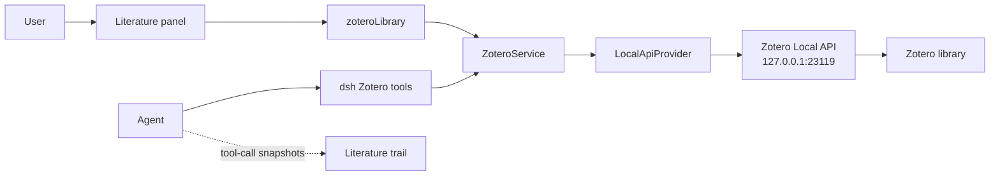

<a href="architecture.md"><b>中文</b></a>

# Architecture

## Overview

dsh-zotero is a Cordis service plugin that exposes the `ctx.zotero` service boundary to the host. The literature panel has its own `ctx.zoteroLibrary`, and scholarly retrieval has `ctx.scholarly`. The loader mounts the default-exported `ZoteroService` together with its validated configuration. The plugin is request-driven: loading issues no external or local network request.

## Data Flow

## Components and Boundaries

| Component              | Cordis key                                | Settings namespace | Default | Responsibility                                                              |
| ---------------------- | ----------------------------------------- | ------------------ | ------- | --------------------------------------------------------------------------- |
| `dsh-zotero`           | `zotero` (wire namespace `zotero`)        | `zotero`           | Enabled | Connection, model tools, literature trail, settings page, `/zotero` command |
| `dsh-zotero/library`   | `zoteroLibrary` (wire namespace `zotero`) | `library`          | Enabled | Host endpoints and right-sidebar interface of the literature panel          |
| `dsh-zotero/scholarly` | `scholarly`                               | `scholarly`        | Off     | External scholarly index search and full-text reads                         |

The three are not peers of one kind. The core holds the data plane and the agent capabilities. The literature panel component has no tools, no prompt section, and no transport of its own; its endpoints all forward to the core, and it is split out so it can be disabled as a whole and keep its own settings. The scholarly retrieval component is the external authorization boundary: while it is not mounted, its service, transport, and tools do not exist.

## Core Layers

### Service Layer (`src/service.ts`)

- `ZoteroService` extends Cordis `Service` and registers as `ctx.zotero`;
- It schedules providers, gates capabilities, and provides the unified entry point for domain operations;
- Configuration is based on the Loader entry, and settings changes are committed to the same entry through `loader/volatile-update`;
- Structural configuration changes rebuild the HTTP client, provider, and write tool set on the existing instance. The trigger is any of the six keys in `TRANSPORT_CONFIG_KEYS` (`baseUrl`, `timeoutMs`, `maxResponseBytes`, `maxInFlightRequests`, `writeAuthorizeDeadlineMs`, `writeEnabled`); other limits are read live by the provider and do not trigger a rebuild;
- Write gates converge at the service seam: every write operation receives a `ZoteroWriteCall` and passes in order through the capability check, the session approval policy (`ctx.approval.request`), and the plan review card;
- It registers a `tools/pre-execute` listener that detects shell commands writing directly to the local API and escalates them to an approval request;
- Transport rebuild policy and the config-to-limits projection live in `src/service-config.ts`. `src/tool-registration.ts` owns the local tool registry, `src/tool-diagnostics.ts` installs the tool-call diagnostics hook, and the service keeps the fiber lifecycle and the composition of these collaborators;
- Configuration commit validation and volatile-update listeners live in `src/service-lifecycle.ts`; ZoteroService provides the live config and the callbacks that rebuild transport and tools;
- The architecture is request-driven: plugin loading issues no external or local network request.

### Provider Layer (`src/local/provider.ts`)

- `LocalApiProvider` implements the `ZoteroProvider` interface;
- It provides search, metadata, attachments, citation, browse, retrieve, changes, and other core capabilities; write capabilities are offered only with explicit configuration and authorization in place;
- The plugin resolves search and browse scope names from its own cached listings. The cache listings are held by the scope directory and rebuilt together with the transport. The `trash` scope (the `/items/trash` listing) is a search scope reserved for the literature panel, and the model tool input schemas do not offer it;
- Collection and saved-search name and hierarchy resolution live in `src/local/scope-directory.ts`; the instance-isolated cache of global item types, fields, and creator types lives in `src/local/item-schema-directory.ts`, and browse and writes share the same schema directory;
- Read-path concurrency is bounded by two limits, `searchConcurrency` and `graphConcurrency`, so a single call does not overload the local API;
- The note content scan runs on the first page (offset 0) within the configured limits;
- Query parameter encoding lives in `src/local/search-query.ts`; path segments come from `src/local/scope-paths.ts`;
- Full-text reads, coverage interpretation, and attachment source facts live in `src/local/retrieve-fulltext.ts`; changes cursor identity, coverage, and version construction live in `src/local/changes-cursor.ts`;
- Scope listing normalization and name matching live in `src/normalize-scope.ts`, and saved-search condition decoding lives in `src/normalize-saved-search.ts`; search hits, item details, child rows, and shared context live in `src/normalize-search.ts`, `src/normalize-item-detail.ts`, `src/normalize-children.ts`, and `src/normalize-context.ts`;
- Passages are ranked with the BM25 term frequency algorithm;
- Export follows the single-request limits of Zotero's local API. The five formats other than `citation` fetch all items in one request (at most 50 `itemKey` values) and are refused above that. `ris` and `csljson` need only that batch request; `bibtex` and `biblatex` send one more metadata batch in parallel to align the export with each item. `citation` sends multiple requests in groups of 50; per-document location inside the merged body serves the tool result only — the panel endpoint takes rendered text/citations only;
- The write domain supports cross-library item relations (`dc:relation`), and group library items are mapped automatically to canonical `http://zotero.org/groups/<id>/items/<key>` URIs;
- Commit proof for non-idempotent writes, refusal mapping, and `committed-unverified` results are centralized in `src/local/write-verdicts.ts`; operation domains only build requests and interpret verified receipts;
- Saved searches, collections, tag/collection membership, notes, batch writes, Trash restore, and library-wide tag deletion live in `src/local/write-saved-searches.ts`, `write-collections.ts`, `write-item-lists.ts`, `write-notes.ts`, `write-batch.ts`, and `write-library-maintenance.ts`, reusing the versioned write primitives centered on `write-domain.ts`.

### Background Job Engine (`src/job-runner.ts`)

- It integrates deeply with the Harness `ctx.jobs` task subsystem;
- It supports explicit background execution (`run_in_background: true`) and automatic promotion when a foreground wait times out (`promoteOnTimeout: true`, controlled by `foregroundWaitMs`);
- Signals are decoupled: a background job has its own `AbortController`, so a caller turn timeout or cancellation leaves an already published background job running;
- Channels are isolated: streaming progress reports through `{ channel: 'log' }` to the web top bar and the log stream without polluting the model context, and the completed result is written to `JobOutcome.result`;
- Jobs start and free resources on demand, and no resident polling daemon runs.

### HTTP Transport Layer (`src/http-client.ts`)

- It supports only loopback HTTP requests and pins API version 3;
- It verifies instance identity consistency through the `Zotero-Server-ID` request header;
- It enforces a read size limit for streaming responses (`maxResponseBytes`);
- It enforces a global in-flight request limit (`maxInFlightRequests`, default 8) that manages the concurrency slots of all tool calls;
- Redirects are strictly forbidden, and there are no persistent long connections;
- Timeouts are managed by a fused deadline together with the caller's cancellation signal.

### Passage Retrieval Pipeline (`src/evidence.ts`)

- Tokenization uses `Intl.Segmenter` (CJK-aware), and tokens are folded with the same `normalizeForSearch` rules Zotero uses; folding applies only on the matching side, and output text stays verbatim;
- BM25 parameters are k1=1.2 and b=0.75; term frequency is measured against the item's own passage collection as the corpus;
- Zero-score passages are excluded: a passage that shares no term with the query is not included in the results.

## Scholarly Literature Subsystem (`src/scholarly/`)

`dsh-zotero/scholarly` is an independent bundle component, shipped with the package but disabled by default. Whether the component is mounted is the only authorization: mounting registers seven model tools and the component's own prompt section and allows requests to the external indexes in the explicit allowlist; while it is not mounted, its service, transport, and tools do not exist.

- Authorization and prompt share one source: the policy prompt is registered by the component itself (`src/scholarly/prompt.ts`, section name `scholarly:policy`), appears when the component mounts, and disappears when it unmounts; the parent component's policy section mentions no external tool.
- Host allowlist: `src/scholarly/transport/hosts.ts` is the single source of truth; both the allowed hosts and the per-host rate interval derive from `SCHOLARLY_HOSTS`.
- Transport: deadlines use `deadline()` and `timeoutOf()` from `@deepseek-ai/dsh-timeout`, which distinguish a provider timeout from a caller cancellation (the latter is not retried); the response body limit comes from the shared `src/transport-bounds.ts`; in-flight requests are bounded by `ConcurrencyGate`.
- Credentials: of the three API keys declared with `role('secret')`, Semantic Scholar and OpenAlex travel in request headers; NCBI E-utilities accept the key only as a query parameter, so that key crosses the URL, and error messages report only the hostname without interpolating the full URL.
- Full-text cache: `src/scholarly/fulltext/store.ts` stores one JSON document per key under `dshCachePath('zotero-scholarly')` and keeps only eight index entries in memory; a read result is one of `hit`, `miss`, or `corrupt`, and a corrupt entry is evicted and recorded.
- Failure semantics: each full-text resolution route records its own failure reason, and the terminal error lists them one by one; `scholarly_verify` uses four verdicts to distinguish "the registry says it does not exist" from "the registry cannot be reached".
- Public surface: `src/scholarly/index.ts` exports only the service class, the configuration schema, and domain types; transport, host table, store, and fusion internals are not exported.

## Library Subcomponent (`src/library/`)

- Service: `ZoteroLibraryService` (derived from `TypertRemoteService`) registers `ctx.zoteroLibrary` and owns the `library` settings namespace; its endpoints are `browse`, `search`, `item`, `childPage`, `export`, and `write`. Read-only endpoints all forward to the core through `requireZoteroService`; writes enter the standard write approval chain through `executeLibraryWrite`;
- Configuration: `LibraryConfigSchema` in `src/library/config.ts` has only one volatile switch, `rightSidebarEnabled`; the host does not read it, and the switch is consumed entirely by browser-side gating;
- Page size: the `limit` requested by the panel is clamped by the host to the core's `maxBrowseResults` and `maxSearchResults`, and the response echoes the effective value;
- Export endpoint: `export` reuses the core export text domain (same formats, same `defaultStyle`/`defaultLocale` defaults, same `maxExportRefs` cap; rendered text/citations only, without the tool-side per-document location) for the panel action row to copy citations; it is a read-only endpoint and does not go through write approval;
- Export surface: `package.json` publishes `./library`, `./library/locale/*.json`, and `./library/icon`, independent of the root exports.

## Browser Client (`src/client/`)

A single client artifact (`lib/client.js`) contains all interfaces. Every surface registers after `remote.zotero` is mounted; the literature panel and its configuration row are additionally guarded by `whileServed('library')`: when the `library` row is not composed, no panel surface registers and no `zotero/browse|collectionPath|search|item|childPage|export|write` call is made.

### Conversation Literature Trail (`conversation.view`, id `zotero`, order 30)

- Data source: the session projection `ChatSnapshot`, taking only visible `zotero_*` tool calls; the reducer (`src/client/sources/reducer.ts`) folds them into a per-item `SourceWorkspace`. Running, failed, and stopped calls count only toward `operations` and never become results; only successful, structurally valid calls produce facts.
- Search folding: paginated continuation calls fold by identity into one search; the first screen's `total` and `noteMatches` come from the first call, while `returned` and `omitted` accumulate across pages.
- Interface structure: the top lens bar switches between the "Literature" and "Exports" views; the item inspector has three panels, overview, passages, and exports; the session-level exports page is segmented by format and deduplicated across items.
- Gating: when `webEnabled` is false the whole page is hidden, and the switch hot-reloads; the page stays visible until the first snapshot arrives.
- Read-only: there are no write controls; actions such as "Ask" and "Export citation" only prefill the session draft and never submit automatically.

### Literature Panel (`sidebarRightTabs` + `sidebar.right.pane.tab`)

- Gating: the component row is composed, the core `webEnabled` is on, and the panel `rightSidebarEnabled` is not false; the panel mounts only when all three hold, and switch changes take effect immediately.
- Data plane: `useLibraryFeed` holds all of the panel's wire calls; `library-data-plane.ts` coalesces identical requests and applies short TTL caches (browse 30s, item 10s, export 10s, search/childPage 2s, `collectionPath` never cached, at most 128 entries) and re-keys the cache by `serverId`; only successful reads are cached, and writes do not pass through this layer.
- Session binding: the panel tab is session-scoped; local attachments open in that session's right reader, and write approvals and plan cards go to that session.
- State and accessibility: panel preferences and view pins are stored in `localStorage` by `serverId`; detail payloads and probe snapshots are kept in memory per session (up to eight sessions); the collection tree uses an ARIA tree, roving tabindex, and arrow keys.
- Layout: the wide three-column layout switches through the anonymous container query `@container (min-width: 720px)`; narrow screens use segmented navigation (navigation, list, detail), with refinements at 640/520/460/360px.
- Races: the collection tree is owned by `useLibraryNavigation`'s instance generation, per-prefix library version, and in-flight deduplication, so no other lane's stale answer merges into it; the list, inspector, and child lists each use an independent sequence number, and a late stale response is dropped by sequence; child paging goes through the dedicated `childPage` endpoint.
- Request discipline: no panel request is sent before the probe returns; no request is sent from the offline segment; no new request starts after the panel closes.
- Write entry: shown when `writeEnabled` is on and the personal library is selected; it can be submitted only while the owning conversation is running.
- Citation copying: the action row copies CSL citations, BibTeX, and other formats through the `zotero/export` endpoint, and the panel takes the rendered text/citations from the same source as `zotero_export` (never the tool-side per-document location); failures are shown in place and are not retried automatically.

### Tool Cards and Command Card

- Tool cards (`tool.call.toolview`): each of the 23 local model tools and `scholarly_save_to_zotero` has a compact collapsible card, and the other six scholarly retrieval tools fall back to the generic row defined by the official contract. A card renders only output the tool already produced, calls no tools itself, and offers copy buttons for values worth copying; "Read PDF" opens the source in the right sidebar.
- Command card (`conversation.chat.commandview`): it provides for `/zotero` a connection status light, version and Server ID details, offline troubleshooting suggestions, and an in-place refresh button. Structured facts come from the host-registered `zoteroStatus` session projection; a live probe started by an in-place refresh outranks the projection.
- Argument access and error boundaries: cards and the trail reducer read `block.args` uniformly through `argsViewOf(block)`; `ZoteroSurfaceBoundary` wraps the literature trail page and `ZoteroCardBoundary` wraps all tool cards, so a render failure degrades in place and does not escape upward.

### Settings and Plugin Management Surfaces

- `plugins.bundle.config` carries the unified 6-tab configuration form on the plugin detail page (General, Connection, Search & Extraction, Literature panel, Scholarly Search, Advanced), manages the `zotero`, `library`, and `scholarly` namespaces, and keeps uncommitted drafts;
- `plugins.row.config` provides component-row configuration for `dsh-zotero#library` and `dsh-zotero#scholarly`;
- `plugins.bundle.activation` shows a connectivity guide when the plugin is enabled; `plugins.detail.section` provides the live status card and the diagnostics card;
- Write receipts, export metadata, and sync diff/job are decoded by `write-decoder.ts`, `export-decoder.ts`, and `sync-decoder.ts`, and the other tool results are decoded by `decoders.ts`.

## Remote Communication and Settings

- The host half registers Typert endpoints in the `zotero` wire namespace through `ZoteroRuntime` (`zoteroRemote`) and `ZoteroLibraryService` (`zoteroLibrary`). `ZoteroRuntime` handles `status`, `resolveAttachment`, `diagnostics`, and `reportClientError`; `ZoteroLibraryService` handles `browse`, `search`, `item`, `childPage`, `export`, and `write`;
- The browser half mounts the namespace through `ctx.remote.$mount`, and configuration reads and writes go through the shared settings forms of the `zotero`, `library`, and `scholarly` namespaces;
- Every configuration field is declared volatile and supports hot reload.

## Diagnostics and Logging

The plugin maintains an in-process diagnostic ring buffer of 500 entries (`src/diagnostics.ts`) that records runtime errors, degraded features, and render crashes:

- Record sources: HTTP requests, tool calls, job states, configuration changes, write gates, shell intercepts, connection probes, and degradation events write structured entries through `DiagnosticSink`; the service mounts a fiber-lifecycle log exporter that captures `ctx.logger` output from the plugin subtree by name prefix.
- Retention level: the diagnostics panel is hidden by default; after "Diagnostics" is enabled, request lines and call summaries are recorded as well, consecutive identical entries merge and increment `count`, and messages and detail fields have length caps.
- Reading endpoint: `zotero/diagnostics` returns a snapshot in reverse chronological order (total, truncation flag, debug switch); the frontend diagnostics card polls only when diagnostics are enabled and the panel is visible.
- Frontend error reporting: the component error boundaries and the `ctx.slots.onEntryError` supervision channel cover two disjoint sets of crashes, both writing to the same ring buffer; the latter filters by the `registrant` ownership stamp written at registration and accepts only entries from this plugin.
- Interface presentation: the diagnostics card supports level filtering, latest entries, and truncation notices, and offers one-click copy of the diagnostic bundle.
- Data safety: records stay in memory only, never touch disk, and send no telemetry; HTTP records contain only method, path, status code, and duration, and response bodies and literature text never enter the buffer.

## Design Boundaries

- Library permissions: read-only by default; with `writeEnabled` on, writes are allowed to the personal library only (`zotero://user/0/`);
- Network boundary: local requests are strictly limited to loopback addresses (`127.0.0.1`, `localhost`, `::1`) and redirects are refused; external requests come only from the scholarly retrieval component;
- Process management: no background polling daemon and no telemetry collection; long tasks are managed on demand by `ctx.jobs`;
- Passage ranking: BM25 term frequency matching over the item's own passage corpus, with no vector or embedding model;
- Trail boundary: the literature trail shows only facts produced by read tools and exports in this session, never writes, and never literature from outside the library;
- Scope boundary: the Trash is a scope reserved for the literature panel and is not offered by the model tool schemas.

## Navigation state and path endpoint

`useLibraryNavigation` owns continuous prefixes, library versions, deduplication, up to four navigation tasks, restoration and location; `useLibraryFeed` owns items and persistence. Storage uses a v2 key and format without migration, response snapshots or durable leaf conclusions. The read-only `collectionPath({ library, ref, libraryVersion })` endpoint routes through `ctx.zoteroLibrary` → `ctx.zotero` → Local Provider under the browse capability, without adding a model tool. It returns the actual collection rows from root to target together with the library version, and proves that version with a final lightweight listing; per-object versions and cached names never stand in for it. Missing ancestors, cycles and invalid parents fail explicitly. Collection and saved-search pages require valid `Last-Modified-Version`; both codecs reject missing versions. Every page of one prefix shares one library version; when the version moves, only that prefix restarts and no other branch or listing is re-read. The path data plane only merges in-flight requests within a generation and never reuses a settled result.
