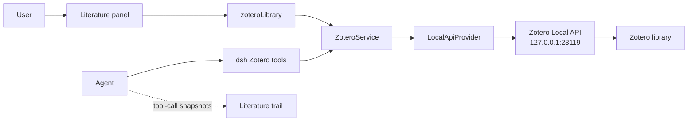

<a href="architecture.md"><b>中文</b></a>

# Architecture

## Overview

dsh-zotero is a Cordis service plugin that exposes the `ctx.zotero` service boundary to the host. The literature panel has its own `ctx.zoteroLibrary`, and scholarly retrieval has `ctx.scholarly`. The loader mounts the default-exported `ZoteroService` together with its validated configuration. The plugin is request-driven: loading issues no external or local network request.

## Data Flow

## Components and Boundaries

| Component               | Cordis key                                | Settings namespace | Default | Responsibility                                                         |
| ----------------------- | ----------------------------------------- | ------------------ | ------- | ---------------------------------------------------------------------- |
| `dsh-zotero`            | `zotero` (wire namespace `zotero`)        | `zotero`           | Enabled | Connection, model tools, literature trail, settings page               |
| `dsh-zotero/library`    | `zoteroLibrary` (wire namespace `zotero`) | `library`          | Enabled | Host endpoints and right-sidebar interface of the literature panel     |
| `dsh-zotero/scholarly`  | `scholarly`                               | `scholarly`        | Off     | External scholarly index search and full-text reads                    |
| `dsh-zotero/enrichment` | `enrichment`                              | `enrichment`       | Off     | Explicit parsing, artifact lookup, and local semantic model management |

The core holds the data plane and agent capabilities. The literature panel component has no tools or prompt section; local-library endpoints delegate to core, while explicit URL PDF reading uses independent permission and shared public-network checks. It is split out so it can be disabled as a whole and keep its own settings. The scholarly retrieval component is the agent's external retrieval authorization boundary: while it is not mounted, its service, transport, and tools do not exist. Enabling the document parsing component accepts MinerU document egress and makes parsing and model management available; every upload still requires the user to submit a specific document and pass session access checks. Its integration separates read-only artifact lookup from explicit parsing, with no model tools or prompt section.

This document keeps the pre-implementation enrichment baseline `a3f4759` only as history; the enrichment behavior described in this chapter is the current implementation. The WP1 read-only seam, WP2 explicit parsing jobs, and WP7 foreground resource draining are implemented, and the chapter describes them as they are.

## Core Layers

### On-demand research skills

`src/skills/` registers 8 research SOPs with optional Harness `ctx.skills`: core owns paper digest, evidence synthesis, manuscript audit and library governance; Scholarly owns landscape discovery, citation lineage, publication integrity and literature intake. Full Markdown instructions load on demand; a short catalog persists, while bodies stay out of the system prompt. Component fibers own registration/teardown, and late or replaced registries rebind automatically. See the [research SOP skill reference](skills.en.md).

Child write isolation includes all 15 core tools and `scholarly_save_to_zotero`. `tools/change` refreshes scoped restrictions using only registered names, covering late Scholarly mount/unmount; the session-lineage execution guard still refuses named child write calls if a view restriction fails.

### Service Layer (`src/service.ts`)

- `ZoteroService` extends Cordis `Service` and registers as `ctx.zotero`;
- It schedules providers, gates capabilities, and provides the unified entry point for domain operations;
- Configuration is based on the Loader entry, and settings changes are committed to the same entry through `loader/volatile-update`;
- Structural configuration changes rebuild the HTTP client, provider, and write tool set on the existing instance. The trigger is any of the six keys in `TRANSPORT_CONFIG_KEYS` (`baseUrl`, `timeoutMs`, `maxResponseBytes`, `maxInFlightRequests`, `writeAuthorizeDeadlineMs`, `writeEnabled`); other limits are read live by the provider and do not trigger a rebuild;
- Write gates converge at the service seam: every write operation receives a `ZoteroWriteCall` and passes in order through the capability check, the session approval policy (`ctx.approval.request`), and the plan review card;
- It registers a `tools/pre-execute` listener that detects shell commands writing directly to the local API and escalates them to an approval request: `bash`/`pwsh` carry the command in `command`, `terminal_send` types its `text` into a shell (a call with `submit: false` executes nothing and is not scanned), and a `run_code` program can assemble the request at runtime, which text detection cannot see;
- The policy section (`zotero:policy`, `src/prompt.ts`) follows each step's admitted tool set: read routing, read caps, and the write policy name only the tools that step admits; any Zotero surface keeps the consent, injection-guard, and connectivity paragraphs; without a local read tool it keeps the write-route guard, and an empty step keeps only that guard; with writes off it keeps the full off-state explanation and out-of-band route ban; the all-tools rendering stays byte-stable;
- Transport rebuild policy and the config-to-limits projection live in `src/service-config.ts`. `src/tool-registration.ts` owns the local tool registry, `src/tool-diagnostics.ts` installs the tool-call diagnostics hook, `src/step-tools.ts` resolves and caches each step's admission once, `src/parameter-correction.ts` installs the parameter hint through `tools/post-execute`, `ResultDelivery` owns delivery only, `src/subagent-guard.ts` holds the subagent write policy (narrowing a child's write-tool visibility by session lineage and denying that child's write calls at execution time), and the service keeps the fiber lifecycle, the composition of these collaborators, and the policy's refresh and teardown;
- Configuration commit validation and volatile-update listeners live in `src/service-lifecycle.ts`; ZoteroService provides the live config and the callbacks that rebuild transport and tools;
- The architecture is request-driven: plugin loading issues no external or local network request.

### Provider Layer (`src/local/provider.ts`)

- `LocalApiProvider` implements the `ZoteroProvider` interface;
- It provides search, metadata, attachments, citation, browse, retrieve, changes, and other core capabilities; write capabilities are offered only with explicit configuration and authorization in place;
- The plugin resolves search and browse scope names from its own cached listings. The cache listings are held by the scope directory and rebuilt together with the transport. The `trash` scope (the `/items/trash` listing) is a search scope reserved for the literature panel, and the model tool input schemas do not offer it;
- Collection and saved-search name and hierarchy resolution live in `src/local/scope-directory.ts`; the instance-isolated cache of global item types, fields, and creator types lives in `src/local/item-schema-directory.ts`, and browse and writes share the same schema directory;
- Read-path concurrency is bounded by two limits, `searchConcurrency` and `graphConcurrency`, so a single call does not overload the local API;
- The note content scan runs on the first page (offset 0) within the configured limits;
- Query parameter encoding lives in `src/local/search-query.ts`; path segments come from `src/local/scope-paths.ts`;
- Full-text reads, coverage interpretation, and attachment source facts live in `src/local/retrieve-fulltext.ts`; changes cursor identity, coverage, and version construction live in `src/local/changes-cursor.ts`;
- Scope listing normalization and name matching live in `src/normalize-scope.ts`, and saved-search condition decoding lives in `src/normalize-saved-search.ts`; search hits, item details, child rows, and shared context live in `src/normalize-search.ts`, `src/normalize-item-detail.ts`, `src/normalize-children.ts`, and `src/normalize-context.ts`;
- Passages are ranked through the `EvidenceRanker` slot: the core defaults to BM25, and enrichment can provide hybrid local semantic ranking;
- Export follows the single-request limits of Zotero's local API. The five formats other than `citation` fetch all items in one request (at most 50 `itemKey` values) and are refused above that. `ris` and `csljson` need only that batch request; `bibtex` and `biblatex` send one more metadata batch in parallel to align the export with each item. `citation` sends multiple requests in groups of 50; per-document location inside the merged body serves the tool result only: the panel endpoint takes rendered text/citations only;
- The write domain supports cross-library item relations (`dc:relation`), and group library items are mapped automatically to canonical `http://zotero.org/groups/<id>/items/<key>` URIs;
- Commit proof for non-idempotent writes, refusal mapping, and `committed-unverified` results are centralized in `src/local/write-verdicts.ts`; operation domains only build requests and interpret verified receipts;
- Saved searches, collections, tag/collection membership, notes, batch writes, Trash restore, and library-wide tag deletion live in `src/local/write-saved-searches.ts`, `write-collections.ts`, `write-item-lists.ts`, `write-notes.ts`, `write-batch.ts`, and `write-library-maintenance.ts`, reusing the versioned write primitives centered on `write-domain.ts`.

### Background Job Engine (`src/job-runner.ts`)

- It integrates deeply with the Harness `ctx.jobs` task subsystem;
- It supports explicit background execution (`run_in_background: true`) and automatic promotion when a foreground wait times out (`promoteOnTimeout: true`, controlled by `foregroundWaitMs`);
- Signals are decoupled: a background job has its own `AbortController`, so a caller turn timeout or cancellation leaves an already published background job running;
- Channels are isolated: streaming progress reports through `{ channel: 'log' }` to the web top bar and the log stream without polluting the model context, and the completed result is written to `JobOutcome.result`;
- Jobs start and free resources on demand, and no resident polling daemon runs.

### HTTP Transport Layer (`src/http-client.ts`)

- It supports only loopback HTTP requests and pins API version 3;
- It verifies instance identity consistency through the `Zotero-Server-ID` request header;
- It enforces a read size limit for streaming responses (`maxResponseBytes`);
- It enforces a global in-flight request limit (`maxInFlightRequests`, default 8) that manages the concurrency slots of all tool calls;
- Redirects are strictly forbidden, and there are no persistent long connections;
- Timeouts are managed by a fused deadline together with the caller's cancellation signal.

### Passage Retrieval Pipeline (`src/evidence.ts`)

- Tokenization uses `Intl.Segmenter` (CJK-aware), and tokens are folded with the same `normalizeForSearch` rules Zotero uses; folding applies only on the matching side, and output text stays verbatim;
- BM25 parameters are k1=1.2 and b=0.75; term frequency is measured against the item's own passage collection as the corpus, never across items;
- The query side is normalized separately: English and Chinese function words do not score, and a repeated term is counted once, so function words in a natural-language question cannot produce pseudo-evidence. Neither the folded index nor the passage text is rewritten, and no term is zeroed merely for appearing in every passage (a term the whole paper discusses is still a valid query term);
- `Intl.Segmenter` only solves word boundaries for scripts without spaces, and function-word filtering only removes function-word noise; neither changes the fact that ranking is term-overlap based;
- The lexical route excludes zero-score passages: a passage sharing no term with the query is not included in that route's results.
- Ranking runs through the `EvidenceRanker` seam in `src/local/evidence-ranker.ts`: the core ships a complete lexical BM25 ranker, and enrichment installs a hybrid ranker when mounted with semantic search enabled (lexical plus local semantic vectors, fused by RRF, with no MinerU call). Local retrieve and `scholarly_read`'s query path both admit a releasable ranking scope before source I/O, fixing the config, model target, and service generation for the whole read, and release it after reading; a request that has not started ranking may still lazily load its fixed target after unmount. Results carry `rankedRoutes`, so empty answers describe only the routes actually run; `matchKind` labels the matching route, and RRF scores only order results.
- The `scholarly_search` topic routing is not semantic routing: `src/scholarly/router.ts` holds two regex phrase tables, and `routeQuery()` branches on phrase hits to pick sources.

## Scholarly Literature Subsystem (`src/scholarly/`)

`dsh-zotero/scholarly` is an independent bundle component, shipped with the package but disabled by default. Whether the component is mounted is the only authorization: mounting registers seven model tools and the component's own prompt section and allows requests to the external indexes in the explicit allowlist; while it is not mounted, its service, transport, and tools do not exist. The client shows the external-retrieval disclosure while the component is served and this browser has not acknowledged the current enable; the acknowledgement covers only that enable, so turning the component off and on again discloses again, while reloading with it still on does not. The disclosure explains the authorized request scope and is not a second switch.

- Authorization and prompt share one source: the policy prompt is registered by the component itself (`src/scholarly/prompt.ts`, section name `scholarly:policy`), appears when the component mounts, and disappears when it unmounts; it names only the tools the step admits and renders nothing when that set is empty; the web_fetch route ban survives any admitted external scholarly tool; the parent component's policy section describes no external retrieval tool and only classifies the save entry by name when that entry is on the step's surface.
- Host allowlist: `src/scholarly/transport/hosts.ts` is the single source of truth; both the allowed hosts and the per-host rate interval derive from `SCHOLARLY_HOSTS`.
- Address safety: the allowlist judges names only. Ports are restricted to 80 and 443 (an explicit spelling equals the default port); the open-access PDF arm (`allowPublicPdf`) — the only arm that leaves the allowlist — must also pass a second gate: `src/transport/network.ts` resolves the hostname and refuses any non-public unicast answer (including the NAT64 and IPv4-mapped embedded-address judgments), then pins the validated set into the undici connection (`connections.ts`) so DNS rebinding cannot re-bind the socket between check and connect. Every redirect hop re-runs the lexical gate and its own resolution. The second gate has one documented fake-IP exception: when the local resolver answers inside `198.18.0.0/15`, a reviewed allowlist hostname is accepted, an open-access PDF target is accepted only over HTTPS, and the MinerU transport accepts it only over HTTPS as well (every MinerU address is HTTPS and its token stays host-scoped to `mineru.net`), where the TLS certificate binds the peer to the requested name; plain-HTTP PDF targets, URL PDF reading, plain-HTTP MinerU targets, and model downloads still require a validated public address. The allowlist arm is HTTPS-only. A dispatcher is only handed to `publicFetch` from the same undici copy (`connections.ts`); the runtime's global `fetch` ships another copy and rejects that dispatcher before a connection opens, so an external egress never uses the global fetch. When the seams are not wired (`publicAccess` absent), the arm fails loud instead of degrading to an unpinned connection.
- Transport: deadlines use `deadline()` and `timeoutOf()` from `@deepseek-ai/dsh-timeout`, which distinguish a provider timeout from a caller cancellation (the latter is not retried); the response body limit comes from the shared `src/transport-bounds.ts`; in-flight requests are bounded by `ConcurrencyGate`, and retry backoff is paid outside the gate so a rate-limited host does not hold the slot budget; the breaker and pacer key on the bare hostname (no port).
- Credentials: the scholarly config stores only credential-reference names declared with `role('credential-ref')` (`s2ApiKeyEnv`, `ncbiApiKeyEnv`, `openalexApiKeyEnv`); key values never enter the config. `src/scholarly/credentials.ts` resolves them through `ctx.get('credentials')` before every external tool call, and reports `ZOTERO_SCHOLARLY_CREDENTIAL_UNRESOLVED` or `ZOTERO_SCHOLARLY_CREDENTIALS_UNAVAILABLE` for an invalid reference, a missing credentials service, or a reference with no value instead of silently falling back to anonymous access. Of the resolved keys, Semantic Scholar and OpenAlex travel in request headers; NCBI E-utilities accept the key only as a query parameter, so that key crosses the URL, and error messages report only the hostname without interpolating the full URL.
- Full-text cache: `src/scholarly/fulltext/store.ts` stores one JSON document per key under `dshCachePath('zotero-scholarly')` and keeps only eight index entries in memory; a read result is one of `hit`, `miss`, or `corrupt`, and a corrupt entry is evicted and recorded.
- Failure semantics: each full-text resolution route records its own failure reason, and the terminal error lists them one by one; a reason carries the underlying transport code (such as `UND_ERR_INVALID_ARG` or `ECONNRESET`), and a local dispatcher mismatch or a security rejection is neither retried nor recorded against the host's circuit, with the original security message (including the fake-IP hint) surfaced; `scholarly_verify` uses four verdicts to distinguish "the registry says it does not exist" from "the registry cannot be reached".
- Background jobs: `scholarly_read` / `scholarly_search` / `scholarly_verify` reuse the core `ZoteroJobRunner` (`src/job-runner.ts`) under the `scholarly` job kind with a 256 KiB output ceiling; an explicit background request uses `run_in_background`, and a foreground wait is promoted per `enableRunInBackground` / `promoteOnTimeout` / `foregroundWaitMs`; `ZoteroJobRunner.killAll` stops the component's own jobs when it unmounts.
- Public surface: `src/scholarly/index.ts` exports only the service class, the configuration schema, and domain types; transport, host table, store, and fusion internals are not exported.

## Document Enrichment Subsystem (`src/enrichment/`)

`dsh-zotero/enrichment` is an independent bundle component, shipped with the package but disabled by default. It registers no model tools, prompt section, or skills. Enabling the component accepts MinerU document egress and makes parsing and model management available; every upload still requires the user to submit a specific document and pass remote-action and session checks, and the client shows the egress disclosure whenever the component is served until this browser acknowledges the current enable, so a deployment already enabled at boot sees it too. The acknowledgement covers only that enable: once the client observes the component off, the next enable discloses again, while a reload with it still on does not.

### Read-only artifact seam

The core `ZoteroService` keeps two pure interface slots from `src/local/`. `FulltextEnhancer` (`fulltext-enhancer.ts`) exposes only `lookup`, with no `enhance`, raw document bytes, or upload operation; `EvidenceRanker` (`evidence-ranker.ts`) uses the core's complete BM25 ranker when empty. The component installs them through `ctx.inject(['zotero'])` and withdraws them on unmount. The dependency direction remains enrichment → core. MinerU transport, host table, credentials, artifact storage, source index, embedding runtime, and model downloads belong to enrichment.

The `best`, `specified`, and `allIndexed` PDF paths in `zotero_retrieve` and the PDF branch of `scholarly_read` only look up valid Markdown for the same source. A hit takes priority, including a valid short document. On a normal miss, local reads use Zotero `/fulltext`, and scholarly reads use the existing authorized PDF download followed by `extractPdfText()`. Abstracts, notes, and annotations retain their own sources. Existing valid artifacts always remain readable. An absent artifact or changed source stamp is a normal miss; permission, I/O, and corrupt-protocol failures must be reported rather than swallowed as misses.

`lookup` checks the source index first and does not probe a source without a candidate artifact. With a candidate, it may stat a local attachment or issue at most one token-free HEAD to validate a URL. It never downloads a document, contacts MinerU, or creates or resumes a parsing task. If validity cannot be established, it neither serves stale Markdown nor reparses implicitly. Ordinary reads, PDF opening, settings saves, and service startup all follow this constraint.

### Explicit parsing and job lifecycle

Parsing targets form the closed union `{kind:'attachment',ref}` or `{kind:'url',url}`, covering child attachments, top-level PDF attachments, and specific public PDF URLs. Host paths, session files, raw bytes, and unknown fields are refused. A request carries the session and an idempotency identifier for each user action, with the mode fixed to the committed config snapshot. The host validates attachment refs, instance, library, and PDF type; public URLs pass per-hop public-address checks, DNS pinning, and port, redirect, byte, and PDF-signature validation.

Before submission, the interface must show the target name or redacted URL, MinerU, the selected mode, what uploading means, and the limits. Only an explicit submission calls the short endpoints owned by enrichment. Uploading requires the component to be enabled, the user to submit the specific target, and remote-action and session access. Neither scholarly nor `library.allowUrlPdfRead` reading permission can be reused for uploading. Parsing needs no query or semantic model. A failure remains a failure, without switching mode or presenting locally extracted text as a successful parse. New interfaces add no aliases or migrations for legacy names, config, or cache formats.

`documentArtifact` uses a strict `op` union: `inspect` validates the source and returns metadata; `open`, with a client UUID `requestId`, fixes the configuration directory, source record and artifact, returning a read lease, image manifest and first text block; `page` and `image` read that fixed version by lease; `release` idempotently releases by requestId. Text blocks contain at most 65,536 characters. A lease belongs to the real peer, session and original Agent instance, with authorization checked before reads and after asynchronous I/O. Source validation and Markdown reading each run once; the reader does not load the content list.

The design uses real `ctx.jobs` for session-owned parsing, leaves `JobSpec.toolCall` unset, and fabricates no model tool call. Once started, the host's `EnrichmentParseJobs` holds overlapping, re-armed `wait`s on the job — each successor is armed before its predecessor expires — so every settlement is reported as `awaited` and the harness completion notice never wakes an idle model; the mechanism assumes no fixed upper bound on the job lifetime (queueing, source transfer, and parsing all count), and the settled record stays available for the panel to read its receipt. The session controller resolves an authorized live Agent, including for an idle session; missing jobs, controller, or Agent is an explicit refusal. The frontend is planned to reuse job-controller `watchRows/observe/kill` to observe source acquisition, upload, waiting, result download, validation, and storage, without a resident poller. Idempotency prevents RPC replay; tasks for the same source, mode, and generation share parsing, and each session may read or cancel only its own jobs. Receipts include target identity, generation, mode, cached or new artifact, fingerprint, artifact revision, page count when actually available, character count, and a bounded preview. They expose no host paths, signed URLs, tokens, or document text in logs.

Cancellation must signal abort synchronously and idempotently, and `done` must settle only after actual cleanup. Closing the interface only releases observation; explicit cancellation, session close, or unmount revokes the corresponding waiter, and shared `ParseFlight` work aborts only when its last waiter leaves. Unmount stops admission, kills the component's own parsing jobs and downloads, and awaits cleanup. Reparsing uses a new generation, retains the previous valid artifact, and atomically switches the source pointer only after the new artifact is complete; failure or cancellation does not delete the previous valid artifact. Only an explicit retry may resume an unfinished task; ordinary reading cannot resume it.

At the pre-implementation baseline, `parse-once.ts` completes submit → signed upload → poll → download → unpack → store within one async call, bounded by a total deadline, poll-count limit, and shared flight signal, with no parsing background job. The per-service `ParseFlight` already isolates one waiter's cancellation from others; the current implementation adds the explicit entry points, session jobs, and full cleanup contract described above.

### Foreground reads and model resources

Local retrieve and `scholarly_read`'s query path synchronously admit a releasable ranking scope before any source I/O, fixing the committed config, model target, and service generation, then release it in `finally` around the whole read. Admission does not eagerly load a model. A request that has not started ranking may still lazily load its fixed target after unmount, within its original deadline. A model switch commits only after the new model loads successfully; a failed new target reports failure to its requests while the old instance remains managed and cannot answer for the new target. The old instance is released only after its last scope and actual inference finish.

Unmount immediately withdraws the slots and stops new admission, lets accepted foreground scopes drain, and releases resources once actual load/run work ends; reinjection starts a new generation. Component-owned background parsing and downloads abort and clean up as described above.

### Existing transport and artifact storage

`src/enrichment/transport.ts` owns its request path and reuses `src/transport/`'s lexical public-address gate, DNS resolution and pinned connections, per-hop redirect revalidation, and bounded reads. Signed upload, result-CDN, and cache-HEAD addresses returned by the API are untrusted input. `Authorization` goes only to the fixed `mineru.net` API host, never to signed uploads, result downloads, or source HEADs. Signed uploads add no headers; non-2xx bodies are bounded and URL-redacted. Phase limits include a 30-minute total budget, 900 polls, 60 seconds for submit/poll, 20 minutes for upload, 10 minutes for result download, 20 minutes for source transfer, and 15 seconds for HEAD.

`mode` (`free` / `pro`) selects the API independently; `free` does not resolve a token. An unresolved `pro` reference fails with `ZOTERO_ENRICHMENT_CREDENTIAL_UNRESOLVED`, without a free or anonymous downgrade; existing cached artifacts remain readable without a token. An empty precise `extract_result` is pending, and the final poll adds no extra wait.

Current artifacts under `<outputDir>/<sha256>/` contain `full.md` and `meta.json` (plus `content_list.json` for the precise API, and `images/` for the figures the Markdown references, capped at 512 files, 8 MB each, 128 MB total), with `meta.json` written last as the commit marker. The current source index at `<outputDir>/sources/index.json` records the latest artifact and source stamp by the canonical source's SHA-256 (`mode` lives in the artifact meta and the content cache key), using stat for local attachments and HEAD to compare URL ETag/Last-Modified/Content-Length. Raw URL query and fragment are not written to `meta.json`. `output-dir.ts` uses realpath to validate system roots, home, `~/.ssh`, and `~/.gnupg` (including macOS `/private/etc` and `/private/var`) and reports configuration failures explicitly. `zip.ts` caps total entries at 4096 and wanted entries at 2, refuses duplicate wanted names, unsafe names, and oversized entries, and uses a cancelable Worker to parse Markdown references before decompressing only the referenced figures. Result buffers are transferred back to the Host; archive admission lasts through persistence.

### Local semantic ranking and model assets

Local semantic ranking and MinerU parsing are independent capabilities. Ranking consumes existing text and local models, contacts no MinerU endpoint, and needs no parsing credentials; explicit parsing needs no model. With `enableSemanticSearch` off, ranking uses complete BM25. With it on but the model missing, corrupted, or its runtime unavailable, the read fails with `ZOTERO_ENRICHMENT_SEMANTIC_UNAVAILABLE` instead of silently becoming lexical. Model download failures use `ZOTERO_ENRICHMENT_MODEL_DOWNLOAD_FAILED`.

`src/enrichment-model-catalog.ts` is the pure catalog shared by browser and host. It pins six tiers' physical models, revisions, file sizes and SHA-256 digests, dimensions, windows, licenses, pooling, normalization, and instruction prefixes. The build-side fetcher imports that module directly (Node's type stripping), so no mirror copy exists. Assets default to `~/.dsh/models/<physicalKey>/` or a `semanticModelDir` directory validated by `safe-directory.ts`. Revision-pinned downloads pass the public-address double gate at each hop and have length, streaming-byte, SHA-256, 60-second stall, and 30-minute per-file limits; `manifest.json` is written last. `ModelDownloadManager` is per service, and unmount calls its cancellation logic. Host downloads support no proxy; the CLI supports `--proxy`. Download, installation, and cancellation integrity fixes belong to WP4.

`src/enrichment/semantic/` produces vectors through tokenizer → onnxruntime-web (WASM, Node) → pooling → L2 normalization, with `semantic/bundle.ts` checking the manifest and per-file SHA-256 before loading. Admission is decided by each tier's measured `floor` (absolute cosine gate) and `margin` (tolerance below the best cosine) fixed in `semantic/model-profiles.ts`: the floor sits above that tier's strongest unrelated-corpus cosine, so a wholly unrelated non-empty corpus yields no semantic hit. Duplicate text is embedded once per ranking call, and a bounded vector cache (`lru-cache`, at most 16,384 items / 64 MiB) is shared across requests. All six tiers were measured with real ONNX inference: on a zero-content-overlap paraphrase set semantic recall@4 is 58–96% with 0 unrelated semantic hits. `matchKind` identifies the matching route, and RRF scores express ordering only; term overlap does not prove that a passage answers the question.

## Library Subcomponent (`src/library/`)

- Service: `ZoteroLibraryService` (derived from `TypertRemoteService`) registers `ctx.zoteroLibrary` and owns the `library` settings namespace; its endpoints are `browse`, `collectionPath`, `search`, `item`, `childPage`, `export`, `write`, `readUrlPdf`, and `releaseUrlPdf`. Local-library read-only endpoints forward to the core through `requireZoteroService`; writes enter the standard write approval chain through `executeLibraryWrite`;
- Configuration: `LibraryConfigSchema` in `src/library/config.ts` defines 11 volatile fields. Pure `library-preferences.ts` owns values and defaults; the host validates and enforces URL PDF permission per call, while accepted browser snapshots drive presentation and actions;
- Page size: the `limit` requested by the panel is clamped by the host to the core's `maxBrowseResults` and `maxSearchResults`, and the response echoes the effective value;
- Export endpoint: `export` reuses the core export text domain (same formats, same `defaultStyle`/`defaultLocale` defaults, same `maxExportRefs` cap; rendered text/citations only, without the tool-side per-document location) for the panel action row to copy citations; it is a read-only endpoint and does not go through write approval;
- Export surface: `package.json` publishes `./library`, `./library/locale/*.json`, and `./library/icon`, independent of the root exports.

## Browser Client (`src/client/`)

A single client artifact (`lib/client.js`) contains all interfaces. Every surface registers after `remote.zotero` is mounted; the literature panel and its configuration row are additionally guarded by `whileServed('library')`: when the `library` row is not composed, no panel surface registers and no `zotero/browse|collectionPath|search|item|childPage|export|write` call is made.

### Conversation Literature Trail (`conversation.view`, id `zotero`, order 30)

- Data source: the host session projection `zoteroSources` (`src/session-projection/source-ledger.ts`) first; it folds the whole session log and is not limited by the browser history window. The status endpoint waits for registration and reports `not-composed`, `pending`, `ready`, or `failed`. The loaded `ChatSnapshot` window is used only when the registry is not composed; registration failure is shown as unavailable instead of presenting a partial window as the complete trail. Both usable paths share the reducer in `src/sources/ledger.ts`, which aggregates `zotero_*` calls into a per-item `SourceWorkspace`. The fold is incremental: the service owns one index per session state chain, a view freezes only the items the round touched, and unloading the registration releases every cached fold — no module-level memo remains. The state stays complete; the view delivered to the browser is windowed (transcript-order list heads) and carries exact aggregates computed before the window — filter counts, passage totals, the deduplicated export count, and an exact total per list — so what the window omits is counted honestly, never lost. Running, failed, and stopped calls count only toward `operations` and never become results; only successful, structurally valid calls produce facts.
- Paging behind the window: the lists the window truncated are paged back through the core's `sourcePage` endpoint (`src/source-page.ts`, mounted on the core `ZoteroRuntime`, independent of the optional library component). A request carries the session id, the target list, an offset, and an optional `currentServerId`; every continuation must carry the `revision` the previous answer reported (the session watermark), and a moved trail is refused with `ZOTERO_SOURCE_PAGE_STALE` instead of silently continuing against a different fold. Each call checks the session authorization against the host `ctx.remoteAccess`, folds the complete ledger, cuts a bounded page, and re-checks the authorization and that the session is still open. The browser's `useSourcePage` appends pages on demand: no request while a list fits the window, and a change of list identity (session, target, instance, offset) retires the accepted pages and aborts the in-flight request.
- Instance verdict: the fold keeps each item's qualified `serverIds`; the host does not know the connected Server ID, so the browser materializes `evidenceMatch` from the status probe through `withEvidenceMatch`.
- Search folding: paginated continuation calls fold by identity into one search; the first screen's `total` and `noteMatches` come from the first call, while `returned` and `omitted` accumulate across pages.
- Interface structure: the top lens bar switches between the "Literature" and "Exports" views; the item inspector has three panels, overview, passages, and exports; the session-level exports page is segmented by format and deduplicated across items.
- Gating: when `webEnabled` is false the whole page is hidden, and the switch hot-reloads; the page stays visible until the first snapshot arrives.
- Read-only: there are no write controls; actions such as "Ask" and "Export citation" only prefill the session draft and never submit automatically.

### Literature Panel (`sidebarRightTabs` + `sidebar.right.pane.tab`)

- Gating: the component row is composed and panel `rightSidebarEnabled` is on; core `webEnabled` controls only the literature trail, and switch changes take effect immediately.
- Data plane: `useLibraryFeed` holds all of the panel's wire calls; `library-data-plane.ts` coalesces identical requests and applies short TTL caches (browse 30s, item 10s, export 10s, search/childPage 2s, `collectionPath` never cached, at most 128 entries) and re-keys the cache by `serverId`; only successful reads are cached, and writes do not pass through this layer.
- Access gate: the panel group (tab type, body, title, tab menu, composer button, deliverable and document actions) registers only while the Host grants the global `zotero/browse` action, and the citation export, attachment lookup, and desktop hand-off each answer their own global grant; the write drawer answers the session-scoped `zotero/write` grant and states the refusal instead of offering a submission the Host would reject. The Host's own checks (`ctx.remoteAccess.allows` in `src/library-write.ts`) stay the authority.
- Session binding: the panel tab is session-scoped; local attachments open in that session's right reader, and write approvals and plan cards go to that session.
- State and accessibility: shared preferences come from accepted `ConfigForm` snapshots, with drafts affecting only the settings preview; browsing positions are stored in `localStorage` by `serverId` and conversation; detail payloads and probe snapshots are kept in memory per session (up to eight sessions); the collection tree uses an ARIA tree, roving tabindex, and arrow keys.
- Layout: the wide three-column layout switches through the anonymous container query `@container (min-width: 720px)`; narrow screens use segmented navigation (navigation, list, detail), with refinements at 640/520/460/360px.
- Races: the collection tree is owned by `useLibraryNavigation`'s instance generation, per-prefix library version, and in-flight deduplication, so no other lane's stale answer merges into it; the list, inspector, and child lists each use an independent sequence number, and a late stale response is dropped by sequence; child paging goes through the dedicated `childPage` endpoint.
- Request discipline: no panel request is sent before the probe returns; no request is sent from the offline segment; no new request starts after the panel closes.
- Write entry: shown when `writeEnabled` is on and the personal library is selected; it can be submitted only while the owning conversation is running.
- Citation copying: the action row copies CSL citations, BibTeX, and other formats through the `zotero/export` endpoint, and the panel takes the rendered text/citations from the same source as `zotero_export` (never the tool-side per-document location); failures are shown in place and are not retried automatically.
- Parsed-document manager page (`zotero-parsed-manager`): a standing header button opens one tab per session immediately after `My Library` (both share `order: 1` in the narrow layout, so DOM order keeps the library selector first). One paged `listParsedDocuments` call supplies the list. Each row uses the Markdown H1 captured at commit, or a short artifact id when no title is available, and shows its source, parse time, size, and counts. The page narrows by state and typed text. Selection is scoped to the visible window, so changing the page, filter, or search clears it. Bulk discard sends one request per selected row; failed rows stay selected and appear in the summary, and a deletion that empties the last page moves back one page. Rows open, reparse, or discard by `artifactId`. Discard asks for confirmation and refreshes any open parsed-result tab. The enrichment component must be served to expose the button and tab. The URL parse entry lives in this page. Parsed result page (`zotero-parsed`): resource addresses contain only the session and attachment ref (URL sources use an `artifact` segment with the artifactId, which the host expands back to a concrete source in `expandRequestTarget`); paper titles and item refs live in tab parameters. The Host `ResourceProvider` / `useResource` prepares all Markdown and figures with visible progress, then publishes one complete `MarkdownText` document. A refresh keeps the previous document readable until an atomic replacement succeeds; failure preserves it with an error notice. Preparation releases the Host lease immediately; Blob URLs live until replacement or the last resource holder leaves. Selection actions use the Host `Menu` and consume the text snapshot captured when the menu opened.

### Tool Cards

- Tool cards (`tool.call.toolview`): each of the 23 local model tools and `scholarly_save_to_zotero` has a compact collapsible card, and the other six scholarly retrieval tools fall back to the generic row defined by the official contract. A card renders only output the tool already produced, calls no tools itself, and offers copy buttons for values worth copying; "Read PDF" opens the source in the right sidebar.
- Argument access and error boundaries: cards and the trail reducer read `block.args` uniformly through `argsViewOf(block)`; `ZoteroSurfaceBoundary` wraps the literature trail page and `ZoteroCardBoundary` wraps all tool cards, so a render failure degrades in place and does not escape upward.

### Settings and Plugin Management Surfaces

- `plugins.bundle.config` carries the unified 7-tab configuration form on the plugin detail page (General, Connection, Search & Extraction, Literature panel, Scholarly Search, Document Enrichment, Advanced), manages the `zotero`, `library`, `scholarly`, and `enrichment` namespaces, and keeps uncommitted drafts;
- `plugins.row.config` provides component-row configuration for `dsh-zotero#library`, `dsh-zotero#scholarly`, and `dsh-zotero#enrichment`;
- `plugins.bundle.activation` shows a connectivity guide when the plugin is enabled; `plugins.detail.section` provides the live status card and the diagnostics card;
- Write receipts, export metadata, and sync diff/job are decoded by `write-decoder.ts`, `export-decoder.ts`, and `sync-decoder.ts`, and the other tool results are decoded by `decoders.ts`.

### Unified Context Menus and Literature Interactions (`contextMenus`)

- Workspace file contributions (`dsh-zotero.file`, order 150): when the captured target is a bibliography file (`.bib`, `.ris`, `.csljson`, `.csl.json`, `.biblatex`, `.bibtex`), registers an "View in Zotero library" action; the contribution exists only while the library panel is mounted, and its run opens the `zotero-library` page in the target's captured session;
- Literature item contributions (`dsh-zotero.item`, order 100): provides "Open in Zotero" and "Copy link" for `zoteroItem` targets; a failed launch rejects to the menu's failure toast, and a refused clipboard write reports that the clipboard is unavailable.

### Document Preview Actions (`sidebar.right.tab.document.actions` / `.unpreviewable`)

- Preview toolbar extension: renders a shortcut action in the document preview toolbar for bibliography files (`.bib`, `.ris`, `.csljson`, `.csl.json`, `.biblatex`, `.bibtex`) to jump into the Zotero library panel;
- Unpreviewable empty state extension: offers the same entry when a bibliography file cannot be rendered inline.

## Remote Communication and Settings

- The host half registers Typert endpoints in the `zotero` wire namespace through three services. `ZoteroRuntime` (`zoteroRemote`) handles `status`, `resolveAttachment`, `diagnostics`, `reportClientError`, `openProtocol`, `revokeWriteGrant`, and `sourcePage`; `ZoteroLibraryService` (`zoteroLibrary`) handles `browse`, `collectionPath`, `search`, `item`, `childPage`, `export`, `write`, `readUrlPdf`, and `releaseUrlPdf`; `EnrichmentService` (`enrichment`) handles explicit parsing, artifact receipts, parsed-document management, and semantic-model management: `startDocumentParse`, `documentArtifact`, `documentParseReceipt`, `listParsedDocuments`, `discardParsedDocument`, `semanticModelStatus`, `downloadSemanticModel`, `cancelSemanticModelDownload`, `deleteSemanticModel`, and `verifySemanticModel`. `listParsedDocuments` returns one server-side page in a single call; the optional state and text filters run before the sort and the slice, so `total` counts the filtered rows and the row `title` is the Markdown H1 captured at commit (older artifacts fall back to a short artifact id on the client). The host unions `sources/index.json` with artifact directories by cacheKey (tolerating orphan directories and dangling index records), so the list itself probes nothing and never touches MinerU. The library and inspector badges go through `documentArtifact`'s `probe` — one batched freshness probe per page (bounded concurrency, one index snapshot per batch) that may send one HEAD per URL-backed source, with the same per-ref semantics as a single-target `inspect`. `discardParsedDocument` clears read leases, parse receipts, the artifact directory, the task file and every alias key in one operation. Complete URLs stay on host disk and never enter a wire result. The receiver is the component's own Cordis service, so with the row unmounted the gateway answers `gateway/service-unavailable`;
- The enrichment remote boundary uses `domainCall` from `errors.ts` consistently to preserve domain error codes and distinguish cancellation from Gateway errors. Only the exact `gateway/service-unavailable` code means the component is absent; permission, connection, directory, and protocol failures keep their actual causes;
- The browser half mounts the namespace through `ctx.remote.$mount`, and configuration reads and writes go through the shared settings forms of the `zotero`, `library`, `scholarly`, and `enrichment` namespaces;
- Literature panel settings directly edit 11 `library` preferences and 2 core CSL defaults. `CitationFormController` owns an independent staged model for the latter, shared by both entrances, so saving them never submits drafts for connection or other fields. `tests/client/settings/citation-defaults.spec.tsx` verifies the real form assembly, save refusals and entrance parity; `tests/client/cards/zotero-card-parity.spec.ts` checks that the two core field tables together match the complete host schema. Packaged browser acceptance in `smoke:web-composition` verifies saves and persistence after reload.
- Every configuration field is declared volatile and supports hot reload;
- `openProtocol` protocol dispatch: WSL and Windows environments uniformly use `powershell.exe` to trigger the host protocol handler; the host endpoint throws `zotero/protocol-failed` on failure, and the browser half surfaces it through the `shell.overlay` toast and diagnostics instead of a DOM-anchor fallback.

## Diagnostics and Logging

The plugin maintains an in-process diagnostic ring buffer of 500 entries (`src/diagnostics.ts`) that records runtime errors, degraded features, and render crashes:

- Record sources: HTTP requests, tool calls, job states, configuration changes, write gates, shell intercepts, connection probes, and degradation events write structured entries through `DiagnosticSink`; the service mounts a fiber-lifecycle log exporter that captures `ctx.logger` output from the plugin subtree by name prefix.
- Tool outcomes: a call that entered dispatch records one `tool.result` when its result is published, with warn for failures (and the result's stable `errorCode` when present) and debug for successes; `ms` spans `tools/execute` entry to publication (including post-execute and finalization), while a call denied or cancelled before dispatch carries no `ms`.
- Retention level: the diagnostics panel is hidden by default; after "Diagnostics" is enabled, request lines and call summaries are recorded as well, consecutive identical entries merge and increment `count`, and messages and detail fields have length caps.
- Reading endpoint: `zotero/diagnostics` returns a snapshot in reverse chronological order (total, truncation flag, debug switch); the frontend diagnostics card polls only when diagnostics are enabled and the panel is visible.
- Frontend error reporting: the component error boundaries and the `ctx.slots.onEntryError` supervision channel cover two disjoint sets of crashes, both writing to the same ring buffer; the latter filters by the `registrant` ownership stamp written at registration and accepts only entries from this plugin.
- Interface presentation: the diagnostics card supports level filtering, latest entries, and truncation notices, and offers one-click copy of the diagnostic bundle.
- Data safety: records stay in memory only, never touch disk, and send no telemetry; HTTP records contain only method, path, status code, and duration, and response bodies and literature text never enter the buffer.

## Design Boundaries

- Library permissions: read-only by default; with `writeEnabled` on, writes are allowed to the personal library only (`zotero://user/0/`);
- Network boundary: local requests are strictly limited to loopback addresses (`127.0.0.1`, `localhost`, `::1`), and redirects are refused. Scholarly authorizes external retrieval, and the literature panel independently authorizes user-initiated URL PDF reading. Only enrichment parsing jobs explicitly submitted for a specific target issue MinerU requests; local semantic ranking contacts no MinerU endpoint, and model downloads are separate operations;
- Process management: no resident polling daemon or telemetry collection. Core, scholarly, and enrichment long tasks all use `ctx.jobs`. Background parsing and downloads abort and finish cleanup on unmount, and accepted foreground read scopes drain before release;
- Passage ranking: the `EvidenceRanker` seam — the core's lexical BM25 over the item's own passage corpus, plus the hybrid lexical+semantic ranker the enrichment component installs when its model is enabled;
- Trail boundary: the literature trail shows only facts produced by read tools and exports in this session, never writes, and never literature from outside the library;
- Scope boundary: the Trash is a scope reserved for the literature panel and is not offered by the model tool schemas.

## Navigation state and path endpoint

`useLibraryNavigation` owns continuous prefixes, library versions, deduplication, up to four navigation tasks, restoration and location; `useLibraryFeed` owns items and persistence. Storage uses a v3 key and format isolated by instance and conversation, keeping status and view markers without persisting directory responses or leaf conclusions. The read-only `collectionPath({ library, ref, libraryVersion })` endpoint routes through `ctx.zoteroLibrary` → `ctx.zotero` → Local Provider under the browse capability. It returns the actual collection rows from root to target together with the library version, and proves that version with a final lightweight listing; per-object versions and cached names never stand in for it. Missing ancestors, cycles and invalid parents fail explicitly. Collection and saved-search pages require valid `Last-Modified-Version`; both codecs reject missing versions. Every page of one prefix shares one library version; when the version moves, only that prefix restarts and no other branch or listing is re-read. The path data plane only merges in-flight requests within a generation and never reuses a settled result.

Read result delivery is owned by `result-delivery.ts`, with durable receipts in `zotero_results` and a single complete JSON body in AttachmentStore. `result-route.ts` resolves authenticated persistent event coordinates. The eight read tools share inline/file envelopes; background and promoted jobs persist before completion, while a foreground settle follows the inline budget, and post-execute adds a bounded standard FileBlock to owned job_output. `result-reader.ts` waits for verified EOF before client copy/download. Per-kind child windows and complete reads share the sequential `childPages` source; locations reuse each normalized page with bounded concurrency.

### Explicit user reading of URL PDFs

`src/library/service.ts` resolves a library attachment through core under independent `allowUrlPdfRead` permission, and `src/library/url-pdf.ts` only downloads an already resolved attachment. `src/transport/` shares public-address checks and DNS-pinned connections with scholarly without composing scholarly. Downloads enforce per-hop redirects, HTTPS downgrade refusal, media type, PDF signature, 32 MiB, 60 seconds and two concurrent reads. Revocation cancels active downloads. `pdf-files.ts` owns leases for at most 16 private temporary reading files. The client opens the owning session's existing public reader through `fileAddressFor` / `tab.actions.openResource`, and observes `sidebarRight.openTabs` to release files after the last reader closes. Plugin teardown releases retained files. Saving settings and restoring tabs never downloads. No host repository changes are required.

Verification ownership: `tests/host/library/config-commit.spec.ts` drives the real Loader's commit and refusal paths; `url-pdf.spec.ts` verifies network safety, revocation and bounds, while `pdf-files.spec.ts` checks private permissions and release. Client `settings-acceptance.spec.tsx` covers draft isolation, acknowledgement and copying; `preference-runtime.spec.tsx` covers tab lifetime, scope conditions and insertion; `pdf-reader-lifetime.spec.ts` covers cleanup ownership across hidden and floating tabs. `npm run test:integration` verifies live Zotero, and `npm run smoke:web-composition` verifies the packed browser composition; scripted tests cannot substitute for these checks.

The browser retains only the source attachment ref; restored reader tabs require explicit reload, which downloads again and replaces that tab without persisting download URLs.
