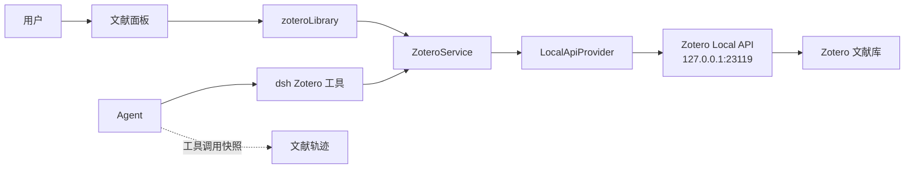

<a href="architecture.en.md"><b>English</b></a>

# 系统架构

## 概述

dsh-zotero 是基于 Cordis 的服务插件，向宿主环境暴露 `ctx.zotero` 服务边界；文献面板另有 `ctx.zoteroLibrary`，学术检索另有 `ctx.scholarly`。加载器将默认导出的 `ZoteroService` 与校验后的配置一同挂载。插件是请求驱动的：加载过程不发起任何外部或本地网络请求。

## 数据流

## 组件与边界

| 组件                   | Cordis 键                                 | 设置命名空间 | 默认 | 职责                                             |
| ---------------------- | ----------------------------------------- | ------------ | ---- | ------------------------------------------------ |
| `dsh-zotero`           | `zotero`（wire 命名空间 `zotero`）        | `zotero`     | 启用 | 连接、模型工具、文献轨迹、设置页、`/zotero` 命令 |
| `dsh-zotero/library`   | `zoteroLibrary`（wire 命名空间 `zotero`） | `library`    | 启用 | 文献面板的宿主端点与右侧边栏界面                 |
| `dsh-zotero/scholarly` | `scholarly`                               | `scholarly`  | 关闭 | 外部学术索引检索与全文读取                       |

三者不是同类同级：核心持有数据面与 Agent 能力；文献面板组件没有工具、没有提示词段、没有自己的传输层，端点全部转交核心，拆出来是为了可整体关闭并拥有独立设置；学术检索组件是外部授权边界，未挂载时服务、传输层与工具都不存在。

## 核心分层

### 服务层 (`src/service.ts`)

- `ZoteroService` 扩展 Cordis `Service`，注册为 `ctx.zotero`；
- 负责 Provider 调度、能力门控与领域操作统一入口；
- 配置以 Loader entry 为基准，设置变更通过 `loader/volatile-update` 提交到同一 entry；
- 结构性配置变更会在现有实例上重建 HTTP 客户端、Provider 与写工具集，触发条件是 `TRANSPORT_CONFIG_KEYS` 中的六个键（`baseUrl`、`timeoutMs`、`maxResponseBytes`、`maxInFlightRequests`、`writeAuthorizeDeadlineMs`、`writeEnabled`）；其余限额由 Provider 实时读取，不触发重建；
- 写入闸门统一收敛于服务接缝：所有写操作接收 `ZoteroWriteCall`，依次通过能力检查、会话审批策略（`ctx.approval.request`）以及计划审查卡；
- 注册 `tools/pre-execute` 监听器，检测直写本地 API 的 shell 命令并提升为审批请求；
- 配置重建策略与 config→limits 投影集中于 `src/service-config.ts`；本地工具注册清单由 `src/tool-registration.ts` 管理，工具调用诊断 hook 由 `src/tool-diagnostics.ts` 安装，service 保留 fiber 生命周期和这些协作者的组合；
- 配置提交校验与 volatile-update 监听由 `src/service-lifecycle.ts` 承担；ZoteroService 提供 live config 和重建 transport/tool 的回调；
- 请求驱动架构：插件加载过程不发起任何外部或本地网络请求。

### Provider 层 (`src/local/provider.ts`)

- `LocalApiProvider` 实现 `ZoteroProvider` 接口；
- 提供 search、metadata、attachments、citation、browse、retrieve、changes 等核心能力，写入能力仅在明确配置且授权就绪时提供；
- 搜索与浏览的作用域名称由插件基于缓存的列表数据自行解析；缓存列表由 scope directory 持有，并随传输层一同重建；`trash` 作用域（`/items/trash` 列表）是文献面板专属的搜索范围，模型工具的输入 schema 不提供它；
- Collection 与 saved search 的名称/层级解析由 `src/local/scope-directory.ts` 负责；全局 item types、fields 与 creator types 的实例隔离缓存由 `src/local/item-schema-directory.ts` 负责，browse 与写入共用同一个 schema directory；
- 读路径的并发由 `searchConcurrency`、`graphConcurrency` 两个限额约束，避免单次调用对本地 API 造成瞬时过载；
- 笔记内容扫描在第一页（offset 0）按限额执行；
- 查询参数编码由 `src/local/search-query.ts` 负责；路径片段由 `src/local/scope-paths.ts` 提供；
- 全文读取、coverage 解释和附件来源事实由 `src/local/retrieve-fulltext.ts` 负责；changes cursor 的 identity、coverage 和版本构造由 `src/local/changes-cursor.ts` 负责；
- Scope listing 规范化与名称匹配位于 `src/normalize-scope.ts`，saved-search 条件解码位于 `src/normalize-saved-search.ts`；search hit、item detail、child row 与共享上下文分别由 `src/normalize-search.ts`、`src/normalize-item-detail.ts`、`src/normalize-children.ts`、`src/normalize-context.ts` 承担；
- 原文片段基于 BM25 词频算法排序；
- 导出遵循 Zotero 本地接口的单次请求限制：除 `citation` 外的五种格式都在单次请求内取回全部条目（`itemKey` 单次上限 50 条），超出直接拒绝；`ris`/`csljson` 只需该次批请求，`bibtex`/`biblatex` 另外并行发出一次元数据批请求，用于把导出结果对齐到各条目；`citation` 按 50 一组发出多个请求；合并正文的逐条文档定位只服务于工具结果，面板端点只取渲染文本/引文；
- 写入领域支持跨库文献关系（`dc:relation`），群组库条目自动映射至规范的 `http://zotero.org/groups/<id>/items/<key>` URI；
- 非幂等写入的提交证明、拒绝映射及 `committed-unverified` 结果由 `src/local/write-verdicts.ts` 集中负责；操作域只负责构造请求和解释已验证回执；
- Saved search、Collection、tag/collection membership、note、批量写入、回收站恢复与全库标签删除分别由 `src/local/write-saved-searches.ts`、`write-collections.ts`、`write-item-lists.ts`、`write-notes.ts`、`write-batch.ts`、`write-library-maintenance.ts` 承担，复用以 `write-domain.ts` 为中心的版本化写入原语。

### 后台任务引擎 (`src/job-runner.ts`)

- 深度集成 Harness `ctx.jobs` 任务子系统；
- 支持显式后台执行（`run_in_background: true`）与前台等待超时自动提升（`promoteOnTimeout: true`，受 `foregroundWaitMs` 控制）；
- 信号分离：后台任务拥有独立的 `AbortController`，调用方轮次超时或取消时，已发布的后台任务继续运行；
- 通道隔离：流式进度通过 `{ channel: 'log' }` 向 Web 顶栏与日志流汇报，不污染模型上下文；完成后结果写入 `JobOutcome.result`；
- 按需启动与释放，不运行常驻轮询守护进程。

### HTTP 传输层 (`src/http-client.ts`)

- 仅支持环回地址 HTTP 请求，固定 API 版本为 3；
- 通过 `Zotero-Server-ID` 请求头校验实例身份一致性；
- 强制限制流式响应读取大小（`maxResponseBytes`）；
- 全局在途请求上限（`maxInFlightRequests`，默认 8），统一管理所有工具调用的并发槽位；
- 严格禁止重定向，无持久长连接；
- 超时由融合后的 deadline 与调用方取消信号共同管理。

### 原文片段检索管线 (`src/evidence.ts`)

- 分词采用 `Intl.Segmenter`（支持 CJK），词元经与 Zotero 保持一致的 `normalizeForSearch` 规则折叠；折叠只作用于匹配侧，原文原样输出；
- BM25 参数为 k1=1.2, b=0.75；词频统计以条目内部片段集合为语料基准；
- 排除零分段落：与查询没有任何词项重合的段落不计入结果。

## 学术文献子系统 (`src/scholarly/`)

`dsh-zotero/scholarly` 是独立 bundle 组件，随包发布但默认禁用。组件是否挂载就是唯一授权：挂载即注册 7 个模型工具与自己的提示词段，并允许向显式允许列表中的外部索引发请求；未挂载时服务、传输层与工具都不存在。

- 授权与提示词同源：策略提示词由该组件自己注册（`src/scholarly/prompt.ts`，段落名 `scholarly:policy`），随组件挂载出现、随卸载消失；父组件的策略段不提及外部工具。
- 主机白名单：`src/scholarly/transport/hosts.ts` 是唯一真源，允许的 host 与每主机限流间隔都从 `SCHOLARLY_HOSTS` 派生。
- 传输层：截止时间用 `@deepseek-ai/dsh-timeout` 的 `deadline()` / `timeoutOf()`，区分“provider 超时”与“调用方取消”（后者不重试）；响应体上限用共享的 `src/transport-bounds.ts`；在飞请求数由 `ConcurrencyGate` 约束。
- 凭证：三个 `role('secret')` 声明的 API Key 中，Semantic Scholar 与 OpenAlex 走请求头；NCBI E-utilities 只接受 query 参数，该密钥经 URL 传递，错误消息只报 hostname，不内插完整 URL。
- 全文缓存：`src/scholarly/fulltext/store.ts` 在 `dshCachePath('zotero-scholarly')` 下按 key 存一份 JSON 正文，内存只保留 8 条索引；读结果分 `hit` / `miss` / `corrupt` 三态，损坏条目被驱逐并记录。
- 失败语义：全文解析的每条路由各自记录失败原因，终态错误逐条列出；`scholarly_verify` 用四值结论区分“注册表说没有”与“注册表联系不上”。
- 公开面：`src/scholarly/index.ts` 只导出服务类、配置 schema 与领域类型；传输、主机表、存储与融合内部实现均不导出。

## 文献库子组件 (`src/library/`)

- 服务：`ZoteroLibraryService`（派生自 `TypertRemoteService`）注册 `ctx.zoteroLibrary`，独占 `library` 设置命名空间；端点 `browse`、`search`、`item`、`childPage`、`export`、`write`。只读端点全部经 `requireZoteroService` 转交核心；写入经 `executeLibraryWrite` 进入标准写入审批链；
- 配置：`src/library/config.ts` 的 `LibraryConfigSchema` 只有 `rightSidebarEnabled` 一个 volatile 开关，宿主不读取它，开关完全由浏览器侧门控消费；
- 页面大小：面板请求的 `limit` 由宿主钳制到核心的 `maxBrowseResults` / `maxSearchResults`，响应回显实际生效值；
- 导出端点：`export` 复用核心的导出文本域（同一格式、同一 `defaultStyle`/`defaultLocale` 默认值、同一 `maxExportRefs` 上限；只返回渲染文本/引文，不做工具侧的逐条文档定位），供面板动作行复制引用；它是只读端点，不经过写入审批；
- 导出面：`package.json` 公开 `./library`、`./library/locale/*.json` 与 `./library/icon`，与根导出相互独立。

## 浏览器客户端 (`src/client/`)

客户端一份产物（`lib/client.js`）包含全部界面。所有表面在挂载 `remote.zotero` 之后注册；文献面板及其配置行额外受 `whileServed('library')` 守卫：`library` 行未组合时不注册任何面板表面，也不发起 `zotero/browse|collectionPath|search|item|childPage|export|write` 调用。

### 会话文献轨迹（`conversation.view`，id `zotero`，order 30）

- 数据来源：会话投影 `ChatSnapshot`，只取可见的 `zotero_*` 工具调用；归约器（`src/client/sources/reducer.ts`）把它们折叠为按条目聚合的 `SourceWorkspace`。运行中、失败、已停止的调用只计入 `operations`，不进入成果；只有成功且结构合法的调用产生事实。
- 检索折叠：分页续调用按 identity 折叠为一次检索；首屏的 `total` 与 `noteMatches` 取第一次调用，`returned`/`omitted` 在续页累加。
- 界面结构：顶部透镜栏在“文献”与“导出”两个视图间切换；条目检查器包含概览、相关片段、导出三个面板；会话级导出页按格式分段并跨条目去重。
- 门控：`webEnabled` 为 false 时整页隐藏，开关热更新；首个快照到达前保持显示。
- 只读：不提供写控件；「提问」「导出引用」等动作只预填会话草稿，从不自动提交。

### 文献面板（`sidebarRightTabs` + `sidebar.right.pane.tab`）

- 门控：组件行已组合、核心 `webEnabled` 开启、面板 `rightSidebarEnabled` 不为 false，三者同时成立才挂载；开关变化即时生效。
- 数据面：`useLibraryFeed` 持有面板的全部 wire 调用；`library-data-plane.ts` 对其做同请求合并与短 TTL 缓存（browse 30s、item 10s、export 10s、search/childPage 2s，`collectionPath` 不缓存；最多 128 条），并按 `serverId` 重新键入缓存；只缓存成功读取，写入不经过该层。
- 会话绑定：面板标签页是会话作用域：本地附件在该会话的右侧阅读栏打开，写入审批与计划卡发往该会话。
- 状态与无障碍：面板偏好与视图钉子按 `serverId` 存入 `localStorage`；详情载荷与探针快照按会话保存在内存中（上限 8 个会话）；合集树使用 ARIA tree、roving tabindex 与方向键。
- 布局：宽屏三列由匿名容器查询 `@container (min-width: 720px)` 切换；窄屏为分段导航（导航 / 列表 / 详情），并有 640/520/460/360px 的细化。
- 竞态：合集树由 `useLibraryNavigation` 的实例世代、每前缀库版本与在途去重负责，其它 lane 的旧结果不会混入；列表、检查器与子列表各自使用独立序号，晚到的旧响应按序号丢弃；子集合翻页走独立 `childPage` 端点。
- 请求纪律：探针返回前不发出任何面板请求；离线段不发请求；关闭面板后不再发起新请求。
- 写入口：`writeEnabled` 且选中个人库时显示；仅当所属会话正在运行时才能提交。
- 引用复制：动作行经 `zotero/export` 端点复制 CSL 引用、BibTeX 等格式，面板只取与 `zotero_export` 同源的渲染文本/引文（不含工具侧的逐条文档定位）；失败就地展示错误，不自动重试。

### 工具卡片与命令卡片

- 工具卡片（`tool.call.toolview`）：23 个本地模型工具与 `scholarly_save_to_zotero` 各有一张紧凑折叠卡片，其余 6 个学术检索工具按官方契约落通用行。卡片只渲染工具已有的输出，自身不调用工具，并对值得复制的取值提供复制按钮；「阅读 PDF」在右侧边栏打开原文。
- 命令卡片（`conversation.chat.commandview`）：为 `/zotero` 输出提供连接状态灯、版本与 Server ID 明细、离线排查建议与就地刷新按钮。结构化事实来自宿主注册的 `zoteroStatus` 会话投影；就地刷新发起的实时探测优先于投影。
- 参数读取与错误边界：卡片与轨迹归约器统一通过 `argsViewOf(block)` 读取 `block.args`；`ZoteroSurfaceBoundary` 包裹文献轨迹页，`ZoteroCardBoundary` 包裹全部工具卡片，渲染异常就地降级，不向上逃逸。

### 设置与插件管理表面

- `plugins.bundle.config` 在插件详情页承载统一的 6 标签页配置表单（基础设置、本地连接、检索提取、文献面板、学术检索、高级选项），管理 `zotero`、`library`、`scholarly` 三个命名空间，保留未提交草稿；
- `plugins.row.config` 为 `dsh-zotero#library` 与 `dsh-zotero#scholarly` 提供组件行配置；
- `plugins.bundle.activation` 在启用插件时弹出连通性引导；`plugins.detail.section` 提供实时状态卡与诊断卡；
- 文献轨迹的写回执、导出元数据与同步 diff/job 分别由 `write-decoder.ts`、`export-decoder.ts`、`sync-decoder.ts` 解码，其余工具结果由 `decoders.ts` 解码。

## 远程通信与设置

- 宿主半侧分别通过 `ZoteroRuntime`（`zoteroRemote`）和 `ZoteroLibraryService`（`zoteroLibrary`）在 `zotero` wire 命名空间下注册 Typert 端点。`ZoteroRuntime` 负责 `status`、`resolveAttachment`、`diagnostics`、`reportClientError`；`ZoteroLibraryService` 负责 `browse`、`search`、`item`、`childPage`、`export`、`write`；
- 浏览器半侧通过 `ctx.remote.$mount` 挂载命名空间，配置读写走 `zotero`、`library`、`scholarly` 三个命名空间的共享设置表单；
- 配置全字段声明为 volatile，支持热重载。

## 诊断与日志

插件维护容量 500 条的进程内诊断环形缓冲（`src/diagnostics.ts`），集中记录运行时错误、功能降级与渲染崩溃：

- 记录来源：HTTP 请求、工具调用、Job 状态、配置变更、写门禁、Shell 拦截、连接探测与降级事件通过 `DiagnosticSink` 写入结构化条目；服务挂载随 fiber 生命周期的日志导出器，按名称前缀捕获插件子树的 `ctx.logger` 输出。
- 保留级别：默认不显示诊断面板；开启「诊断」后额外记录请求行与调用摘要，连续相同条目合并并递增 `count`，消息与详情字段均有长度上限。
- 读取接口：`zotero/diagnostics` 端点按时间倒序返回快照（总数、截断标记、debug 开关）；前端诊断卡仅在开启诊断且面板可见时轮询。
- 前端异常上报：组件错误边界与 `ctx.slots.onEntryError` 监督通道覆盖两组不相交的崩溃，均写入同一环形缓冲；后者按注册时盖的 `registrant` 所有权戳过滤，只认本插件条目。
- 界面呈现：诊断卡支持级别过滤、最新条目与截断提示，并提供诊断包一键复制。
- 数据安全：记录仅保存在内存中，不落盘、不外发遥测；HTTP 记录只含方法、路径、状态码与耗时，响应体与文献正文不进入缓冲区。

## 设计边界

- 文献库权限：默认只读；开启 `writeEnabled` 后仅允许写入个人库（`zotero://user/0/`）；
- 网络边界：本地请求严格限制在环回地址（`127.0.0.1`、`localhost`、`::1`），拒绝重定向；外部请求只来自学术检索组件；
- 进程管理：无后台轮询守护进程与遥测收集，长任务统一交由 `ctx.jobs` 按需管理；
- 段落排序：对条目自身的片段语料做 BM25 词频匹配，不使用向量或嵌入模型；
- 轨迹边界：文献轨迹只展示本会话读类工具与导出产生的事实，不记录写入，也不含库外文献；
- 范围边界：回收站是文献面板专有范围，模型工具 schema 不提供。

## 导航状态与路径端点

`useLibraryNavigation` 独立管理连续前缀、库版本、在途去重、最多四个导航任务以及恢复和定位；`useLibraryFeed` 管理条目与统一持久化。存储键与格式为 v2，不迁移旧记录，不保存目录响应或叶节点结论。新增只读 `collectionPath({ library, ref, libraryVersion })` 经 `ctx.zoteroLibrary` → `ctx.zotero` → Local Provider，使用 browse 能力门控，不新增工具。返回根至目标的真实合集行及库版本；结束时通过轻量列表读取校验版本，不使用单对象版本或名称缓存。祖先缺失、循环与非法父关系明确失败。合集和保存搜索分页必须携带有效 `Last-Modified-Version`，双端 codec 拒绝缺失版本。同一前缀的各页必须共享同一库版本；版本前进时只重启该前缀，其余分支与服务请求不受影响。路径数据面只合并同代在途请求，不复用已完成结果。
