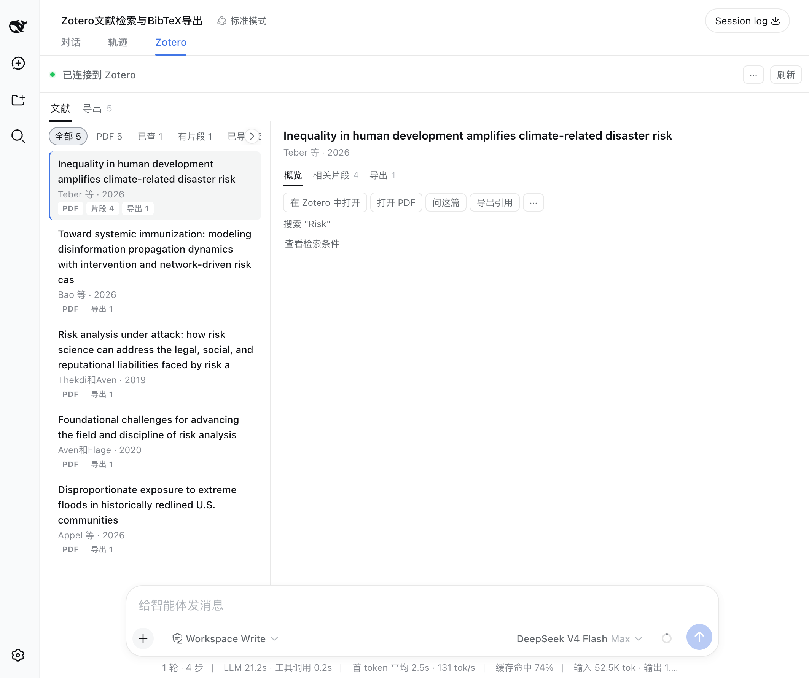
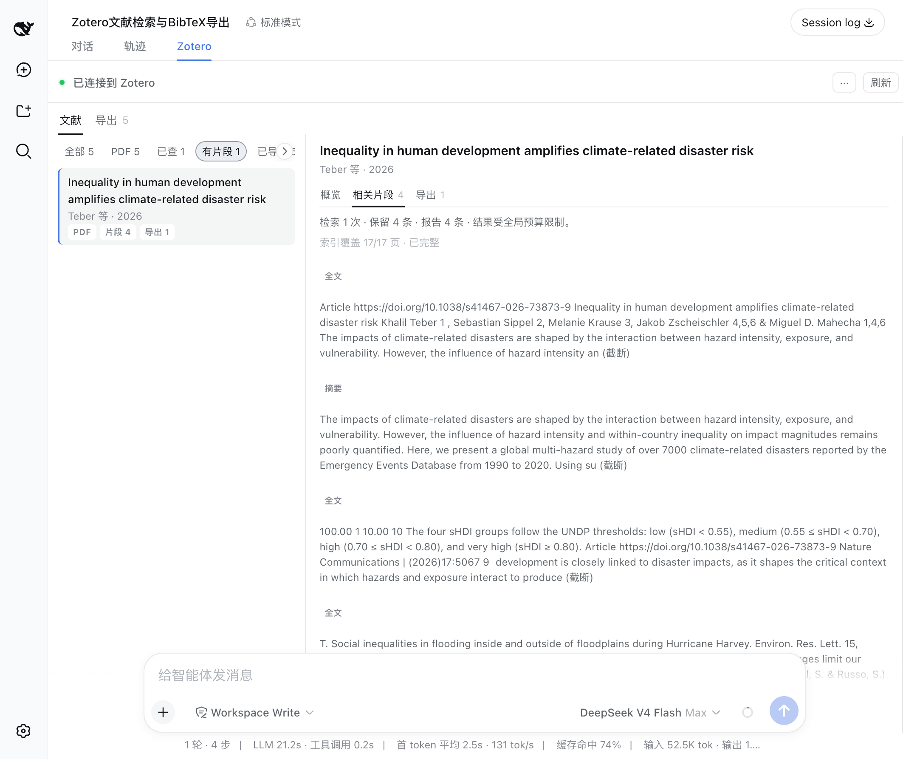
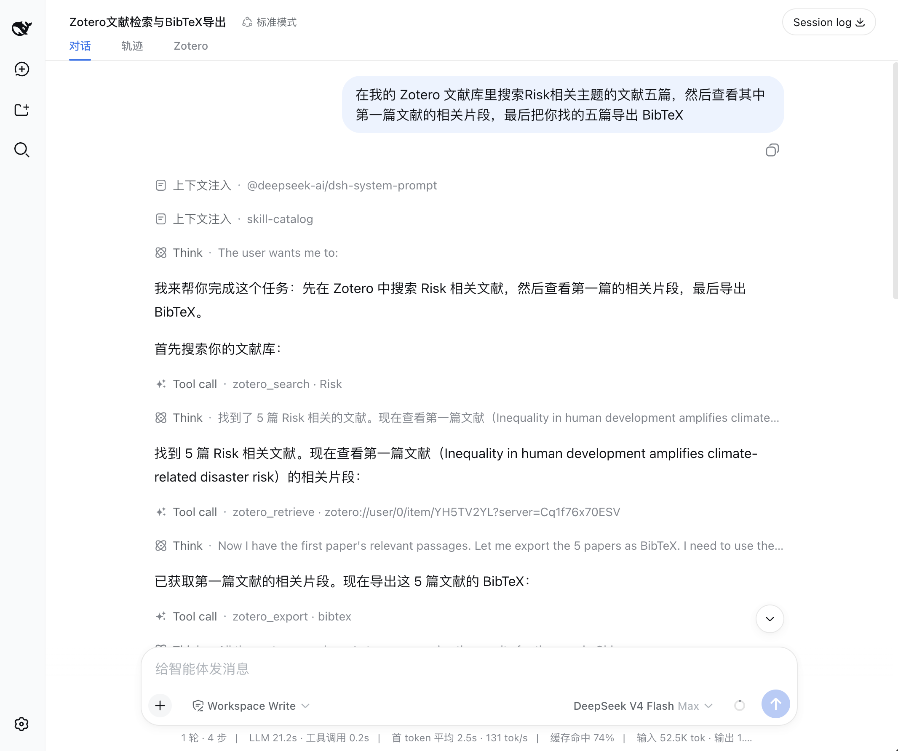

<a href="features.md"><b>中文</b></a>

# Features

dsh-zotero allows DSH LLM conversations to search, inspect, and cite your local Zotero library. Twenty-three local tools cover literature discovery, passage retrieval, source attachment location, formatted export, and personal-library writes. Fifteen personal-library write tools are disabled by default and require session approval and plan review when enabled. The web Sources panel aggregates literature, relevant passages, and exports referenced throughout the session.

## Scholarly Literature Retrieval

Enabling the `dsh-zotero/scholarly` component under "Included components" in the Plugins manager mounts it, and the model can then search beyond the local library: across seven indexes (arXiv, OpenAlex, Crossref, Semantic Scholar, PubMed, Europe PMC, DBLP) with fused, deduplicated ranking; read open-access full texts by DOI / arXiv ID / PMID / PMCID with passage-level location; follow citation networks; pull canonical citation formats from DOI registration agencies (BibTeX, RIS, CSL JSON, CSL-styled text); verify a reference list for fabricated entries and field mismatches; and save an external result to local Zotero only when explicitly requested. While the component is off, those tools do not exist and the host makes no external request.

It complements the local-library capabilities rather than replacing them: hits already in the library are annotated, and the annotation is read-only.

## Literature Search

`zotero_search` invokes Zotero's local quick search:

- Search modes:
  - `metadata` (default): matches title, author, and year;
  - `everything`: additionally queries indexed full-text content.
- Search scopes:
  - Entire library (default);
  - Personal publications (`publications`);
  - Specific collection by name or ref (`collection`);
  - Specific saved search by name or ref (`savedSearch`).

Initial queries (offset 0) scan note bodies in batches, returning matches under `supplemental` without inflating the primary pagination count. Search results return stable `zotero://` references for downstream tools.

## Metadata and Notes

`zotero_get` retrieves structured bibliographic metadata for a single item, including title, creators, publication year, venue, DOI, URL, and abstract.

Use `include` to selectively load child resources:

- `notes`: child notes and their text content;
- `annotations`: PDF annotations, highlighted text, comments, and page labels;
- `attachments`: associated attachments with file types and link modes.

When a note body exceeds the character budget the response sets `truncated: true`, and a cut abstract sets `abstractTruncated: true`.

## Passage Retrieval

`zotero_retrieve` gathers text passages across multiple item sources and ranks them using the BM25 algorithm:

| Source       | Description                                                                                                            |
| ------------ | ---------------------------------------------------------------------------------------------------------------------- |
| `annotation` | PDF annotations: highlights and reader comments rank together with page labels; `matchedFields` indicates match origin |
| `note`       | Chunked child note body text                                                                                           |
| `abstract`   | Item abstract text                                                                                                     |
| `fulltext`   | Chunked full text from Zotero's local index                                                                            |

Full-text coverage is reported via the `coverage` field. Unavailable or unindexed sources are logged in `sourcesSkipped`.

Under multi-attachment policies (`allIndexed` or `specified`), the `attachments` array reports individual attachment status: `indexed` (full text and coverage retrieved), `unindexed` (no index built in Zotero), or `unread` (skipped due to attachment limit).

## Locating Source Attachments

`zotero_attachment` resolves attachment references to accessible locations:

- Local file: returns an on-disk path verified via async `stat`;
- Linked attachment: returns the target URL.

Passing an item ref lets Zotero select the best attachment automatically; passing an attachment ref targets that specific file.

Note: Reading PDF content depends on host environment capabilities; dsh-zotero resolves and validates the path.

## Citation Export

`zotero_export` supports the following output formats:

| Format         | Output                                          |
| -------------- | ----------------------------------------------- |
| `citation`     | Individual HTML citations ordered by input refs |
| `bibliography` | CSL-ordered consolidated bibliography           |
| `bibtex`       | BibTeX entries                                  |
| `biblatex`     | BibLaTeX entries                                |
| `ris`          | RIS text                                        |
| `csljson`      | CSL-JSON data                                   |

Optional `style` and `locale` parameters set the citation format. The five non-`citation` formats accept at most 50 items per call; `citation` is the only format that batches, and it does so only once `maxExportRefs` is raised above 50.

## Optional Personal-Library Writes

When `writeEnabled` is turned on, the plugin registers 15 write tools restricted to the personal library (`zotero://user/0/`):

- `zotero_create_note`: creates standalone notes or child notes with tags, collections, and `dc:relation` links;
- `zotero_update_note`: replaces an existing note body under its version precondition;
- `zotero_update_item_tags`: settles `add`/`remove` in one read-merge-write call, keeping existing tag types, under the item's version precondition;
- `zotero_update_item_collections`: settles `add`/`remove` membership changes in one call, resolving names before any write;
- `zotero_create_collection`: creates a top-level or child collection; a sibling with the same name refuses the write;
- `zotero_update_collection`: renames or reparents a collection;
- `zotero_delete_collection`: deletes a collection (irreversible: its structure and child collections go, the items stay); the plan card states the item and subcollection counts first;
- `zotero_create_item`: creates an item from a closed field set (no BibTeX/CSL-JSON channel); an unknown type or a missing title and URL is refused;
- `zotero_update_item`: corrects scalar metadata, with field validity taken from Zotero's `itemTypeFields`;
- `zotero_restore_items`: restores items from Trash;
- `zotero_create_saved_search` / `zotero_update_saved_search` / `zotero_delete_saved_search`: manage saved-search definitions;
- `zotero_delete_library_tags`: deletes tags library-wide by name (irreversible), stating each tag's item count first; unmatched names are ignored so a retry is idempotent;
- `zotero_batch_items`: creates items, updates tags and collections, and moves items to trash in a single call under one plan card.

Every write requires passing session approval policy and plan card review. Deletion cards state whether items are moved to trash or removed permanently. Zotero 10 also prompts a local authorization dialog on first write.

## Chat Tool Cards (Toolviews)

In DSH conversations, Zotero tool calls render using dedicated read-only cards (`tool.call.toolview`):

- **Search (`zotero_search`)**: displays queries, total hits, expandable item summaries, plus the "Read PDF" and copy-to-locate actions;
- **Passage Retrieval (`zotero_retrieve`)**: displays extracted passage counts, ranked excerpts, page numbers, and index coverage;
- **Export (`zotero_export`)**: shows format badges, copy actions, and formatted download buttons;
- **Item Details (`zotero_get`)**: displays bibliographic metadata, venue details, child item counts, and previews;
- **Child Objects (`zotero_children`)**: partitions child notes, attachments, and highlighted PDF annotations by kind;
- **Library Structure & Changes (`zotero_browse` / `zotero_changes`)**: `zotero_browse` renders collection trees and tag lists; `zotero_changes` displays versioned diffs, deletions, and reusable cursors;
- **Attachment Locator (`zotero_attachment`)**: displays verified file paths or links with one-click copy and open actions;
- **Personal Library Writes (all 15 write tools)**: displays target items, note summaries, planned tag and membership changes, collection/item creation and deletion, Trash restoration, saved-search operations, and library-wide tag deletion; receipts distinguish "applied", "no change", "outcome unreported", and "declined", with irreversible deletes declared on the plan card first.

Cards use compact summary headers by default and lazily render details when expanded, tracking tool lifecycle states throughout execution.

## Slash Command Status Card (Commandview)

Running `/zotero` (or `/zotero status`) in the chat composer renders a dedicated status card:

- Online/offline indicator and summary status;
- Local endpoint address, Zotero version, API and schema versions, Server ID, and write permission state (endpoint address remains visible when disconnected to aid diagnosis);
- Inline Refresh button to re-run local connectivity checks immediately;
- Actionable diagnostic steps when offline or encountering errors.

## Plugin Management and Activation Guidance

The plugin integrates with Harness plugin slots:

- **Activation Guidance (`plugins.bundle.activation`)**: opens an onboarding modal when enabling the plugin, checking local API connectivity and guiding users to enable communications in Zotero preferences;
- **Detail Page Configuration and Status (`plugins.bundle.config` / `plugins.row.config` / `plugins.detail.section`)**: `plugins.bundle.config` carries the unified 6-tab configuration form on the plugin detail page (covering General, Connection, Search & Extraction, Library, Scholarly Search, and Advanced, synchronized across dual channels with the Library and Scholarly sub-row configurations); `plugins.row.config` provides a dedicated sidebar toggles form for `dsh-zotero#library`; `plugins.detail.section` renders the live readiness card that reports connection state, the Zotero version, and diagnostic tips;

## Library Panel and Subcomponent

The library panel is an independent DSH bundle subcomponent (`dsh-zotero/library`) that browses the whole library, searches, inspects items, and runs controlled writes without the Agent. The panel lives in the right sidebar, beside the conversation:

- **Mounting and gating**:
  - **Right sidebar tab (`sidebarRightTabs` + `sidebar.right.pane.tab`)**: controlled by `rightSidebarEnabled` (on by default); the library shows as a right sidebar tab beside the conversation;
  - **Global gate**: the panel also requires `webEnabled`; with `webEnabled: false` it does not mount;
- **Container query layout**: the wide layout switches at the anonymous container query `@container (min-width: 720px)`:
  - **Narrow (< 720px)**: a segmented navigation bar (`Navigation / List / Inspector`); selecting a collection shows the list, selecting an item shows the inspector, and the bar navigates back (with 640/520/460/360px narrow refinements);
  - **Wide (≥ 720px)**: three columns (navigation, item list, inspector);
- **Session binding**: the panel belongs to the conversation its tab is bound to — "Read PDF" opens in that session's right reader, and the write drawer sends its approval and plan card to that conversation;
- **Navigation**: multi-library selection, independently paged collection tree, paged saved searches, My Publications, and Trash; saved-search rows show Zotero's original conditions and keep unknown condition names as strings;
- **Item list**: paged results with metadata/full-text modes, five sort fields and both directions, plus item-type, tag (all/any), inclusive year-range, and attachment-existence filters; the year and attachment filters run one concurrent whole-library candidate scan on the host (the filter index caches each candidate's key, year, and attachment presence per (scope, query, sort, tags, item types, attachment dimension); the year range and attachment value are applied at page time, later pages fetch rows by key in batches, and a library-version change rescans once); the tag filter is an on-demand panel over server-side tag search (requests start on open, input is debounced, pages load until the end); changing a filter, query, scope, or sort returns to offset 0 and clears the inspector; a trailing PDF badge marks rows whose indexed best attachment is a PDF (a detection marker; an unbadged row may still carry files); rows still open the inspector on click;
- **Item inspector**: a head block (item-type eyebrow, title, creators, venue · date) with an action row (read Zotero's chosen best PDF attachment, copy the Zotero link); a clamped abstract with an expand/collapse toggle; the info table, collection and tag chips, and the notes, attachments, and annotations child kinds (each with its own offset/limit pager: the page size is clamped by `maxNoteRecords` and friends, the response carries the effective `limit`, and the total comes from the matching Zotero response; child paging rides a dedicated `childPage` endpoint and never re-reads the parent); the action row additionally offers "Ask" (prefills a question template into the session draft, never auto-submits) and "Add to chat" (appends "《title》 (ref)" at the draft caret), both through the session-scope input face;
- **Attachment reading**: "Read PDF" rides the head action row: local attachments open in DSH's right reader (the same route the Sources panel uses), URL attachments open in a new browser tab; a host refusal degrades to an inline hint;
- **Errors and races**: tree, saved-search, list, inspector, and child lanes expose retry actions; each lane numbers its requests, so a late answer is dropped by sequence;
- **State and accessibility**: preferences and the view pins (selected row, narrow pane) are stored in `localStorage` under the confirmed Zotero `serverId`; malformed or foreign values are discarded. The detail payload and the probe snapshot are kept in memory per session (at most eight sessions; cleared when the session is removed or the plugin unloads). The collection tree is an ARIA tree with roving tabindex and Up/Down/Left/Right/Home/End/Enter navigation;
- **Remount restore**: switching to the PDF reader or another tab unmounts the library tab; on return, once the probe answers, the selected row, the narrow pane, and the last detail payload are back immediately, and the detail then refreshes silently in the background (no loading placeholder);
- **Write entry**: shown when `writeEnabled` is on and the personal library is selected; submittable only while the panel's own conversation is running, with the approval and plan card landing in that conversation. Submission goes through the `ctx.zoteroLibrary` service and `executeLibraryWrite` with capability, session approval, plan review, and version preconditions. Declines, conflicts, and unverified commits render differently; writes are not retried;
- **On demand**: requests start while the panel is open and the connection is confirmed; closing the panel stops new requests from being issued (ones already in flight run to completion on the host). A disconnected probe (or a failed one) replaces the area below the toolbar with the offline note (carrying the diagnosis) and holds all requests until the connection returns. A cached snapshot only paints the first frame and never opens the wire: no `browse`/`search`/`item` request goes out before this mount's own probe answers. Panel searches list items only and skip the tool path's note-body scan.

## Session Sources Panel

The Zotero tab in DSH Web includes two sub-views (Sources, Exports); Passages is a panel inside each item's inspector, with a session-wide overview entry when the session holds passages for several items:

- **Sources**: displays items referenced through search and read tools during the session; the item inspector carries a passages panel grouping the text excerpts `zotero_retrieve` extracted;
- **Exports**: lists all generated citation and bibliography text, with copy and download actions.

## Design Boundaries

- **Read-only by default**: `writeEnabled` is disabled by default; when enabled, writes apply only to the personal library and require dual confirmation;
- **Term frequency ranking**: passage retrieval matches terms with BM25, not vector embeddings;
- **Text exports**: citations and bibliographies return plain text;
- **Session isolation**: the Sources panel maintains an isolated snapshot for the active conversation;
- **Index dependency**: full-text search and retrieval rely on Zotero's local index.
