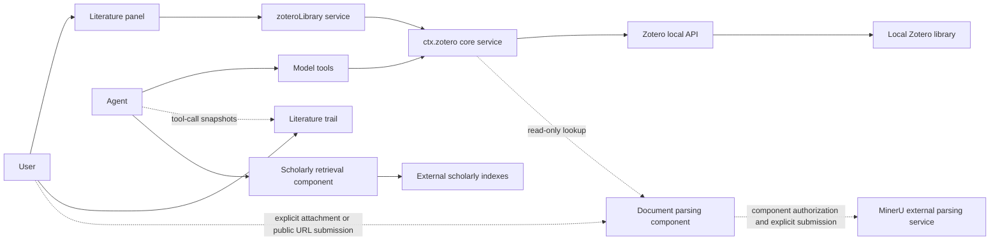

<a href="product-model.md"><b>中文</b></a>

# Product Model

dsh-zotero runs around the local Zotero library. The model uses tools, the human uses the interface, working together through two entry points and two views, backed by four decoupled components.

## Two Entry Points

The system provides independent entry points for the model and the user:

| Entry point        | User     | Interaction channel                             | Responsibilities                                                                                                     |
| :----------------- | :------- | :---------------------------------------------- | :------------------------------------------------------------------------------------------------------------------- |
| **Agent tools**    | AI model | Tool calls (Function Calling)                   | Search, read full texts, locate passages, and generate citations in conversation; modify the library under approval. |
| **User interface** | User     | Browser interface (right sidebar & session tab) | Browse the library, filter items, read PDFs, and copy citations; verify papers and passages queried by the agent.    |

### Separate Responsibilities

The two paths serve separate responsibilities:

- **Interface decoupled from tools**: "Ask" and "Add to chat" in the panel populate item details into the composer for the user to review and send.
- **Background calls preserve UI state**: When the agent calls tools to search or read papers, the active item selection, tree expansion, and scroll position in the literature panel remain unchanged.

## Two Surfaces

The local Zotero desktop app is the single source of truth. The interface offers two views: one for finding literature, and one for checking what the agent did:

| Surface              | Location        | Role                                                                                                                                                                   | Data source                                       |
| :------------------- | :-------------- | :--------------------------------------------------------------------------------------------------------------------------------------------------------------------- | :------------------------------------------------ |
| **Literature panel** | Right sidebar   | **Global library view**: for manual browsing and citing. Navigate collection trees, tags, saved searches, and the Trash; inspect details and read PDFs.                | Local API (via `zoteroLibrary` service endpoints) |
| **Literature trail** | Session top tab | **Session audit view**: for verifying the agent's work. Lists queried papers, search parameters, extracted passages, and export records from the current conversation. | Tool-call snapshots from the current session      |

Their responsibilities are distinct: the literature panel serves global library browsing and citation, while the literature trail audits tool calls and source passages within the current session. The literature panel also owns two derived tabs: a parsed-result page for one document and a parsed-document manager. The manager lists each artifact under its paper title, narrows the list by state and keyword, opens or reparses rows, discards a selected page in bulk, and houses the PDF URL parse entry. Both are views of the literature panel, not a fifth component.

DSH's built-in "Trail" tab records tool-call execution times and raw parameters; the "Literature trail" focuses purely on literature, showing search conditions, source passages, and export records.

## Four Components

The plugin is split into four components with distinct roles:

| Component name              | Role                                                                      | Default state | Partition rationale                                                                                                                                        |
| :-------------------------- | :------------------------------------------------------------------------ | :------------ | :--------------------------------------------------------------------------------------------------------------------------------------------------------- |
| **`dsh-zotero` (core)**     | Local communication, base model tools, literature trail, settings         | Enabled       | Plugin foundation, providing core connections and baseline capabilities.                                                                                   |
| **`dsh-zotero/library`**    | Literature panel service (`zoteroLibrary`) and sidebar interface          | Enabled       | Decouples the library browsing UI so it can be disabled as a whole, with an independent settings namespace.                                                |
| **`dsh-zotero/scholarly`**  | External scholarly retrieval, open-access full text, citation check       | Disabled      | Agent scholarly retrieval authorization boundary; requests to allowlisted indexes and the open-access PDF arm require this component.                      |
| **`dsh-zotero/enrichment`** | User-submitted MinerU parsing, artifact reuse, and local semantic ranking | Disabled      | Enabling accepts MinerU document egress and provides parsing and model management; every upload still requires explicit submission of a specific document. |

### Component Roles

- **Core component**: The plugin body. Manages communication with the local Zotero API (`127.0.0.1:23119`), registers 8 read tools and 15 write tools, and maintains the literature trail and configuration options.
- **Literature panel component**: Exposes read and write endpoints (`browse`, `search`, `item`, etc.) to the frontend. It registers no tools and injects no prompts; local-library operations forward to the core service. Explicit user reading of URL PDFs has its own `allowUrlPdfRead` permission and public download boundary. It can be unmounted entirely if the sidebar is not needed.
- **Scholarly retrieval component**: Provides external academic retrieval for the agent. When disabled, no scholarly tools are registered; when enabled, it registers seven tools querying allowlisted academic platforms (HTTPS) and open-access PDF hosts (with public address validation and fake-IP support). The client displays an outbound disclosure when first enabled, outlining destination hosts.
- **Document parsing component**: Provides explicit document parsing, artifact lookup, and local semantic model management. Enabling the component grants MinerU parsing access; an egress notice is shown on first enable. Ordinary `zotero_retrieve` and `scholarly_read` calls query valid Markdown via `FulltextEnhancer.lookup` and prioritize it, falling back to Zotero fulltext or local PDF extraction on a miss. Local semantic ranking runs independently using local embedding models.

`src/skills/` registers phased instructions through the Harness's optional `ctx.skills`, with the core component owning four and the scholarly retrieval component owning four. The model selects from a catalog of names and short descriptions, then loads the full Markdown body with the `skill` tool; bodies stay out of the standing system prompt. See the [research SOP skill reference](skills.en.md).

### Explicit Parsing Contract

Document parsing is explicitly submitted by the user from the literature panel for a specific Zotero PDF attachment or public PDF URL, displaying the selected mode and destination before submission.

Parsing jobs are managed by the session job system with progress tracking and cancellation. Successfully parsed Markdown is automatically reused in subsequent searches; if parsing is pending or missing, retrieval directly uses existing full-text indexes or local text extraction. Parsing and local semantic ranking are decoupled, allowing semantic search to be enabled independently.

## Data Flow

Both primary paths reach the local library through `ctx.zotero`. Agent external scholarly retrieval requires the scholarly component. Explicit user reading of URL attachments is authorized independently by the literature panel. The enrichment flow reuses existing artifacts for normal reads and initiates external requests only when the user explicitly submits a document.

## Four Boundaries

1. **Write safety**: Write tools are disabled by default. Once enabled, they modify only the personal library (`zotero://user/0/`); all write operations require approval and plan card confirmation, returning an error on failure without automatic retries.
2. **Network isolation**: Local communication connects to loopback addresses (`127.0.0.1`). Agent scholarly retrieval accesses allowlisted index platforms and public open-access PDF hosts; the literature panel supports downloading existing URL attachments via `allowUrlPdfRead`; both PDF download paths perform public address validation and DNS pinning (with fake-IP placeholder support). MinerU document uploads occur only when enrichment is enabled and the user explicitly submits a document, with untrusted dynamic upload URLs verified identically.
3. **Trail scope**: The literature trail displays read tool calls and exports from the current session; writes are recorded on approval cards; external literature enters the trail after being saved to the library.
4. **Scope limits**: The Trash is accessible only in the literature panel; model search tools exclude the Trash. The literature panel is dedicated to the local library, while external literature discovery is handled by the agent.

## Typical Workflows

- **Research and verify in chat**: Ask questions in chat → the agent queries the local library and extracts passages with page numbers → switch to the **literature trail** at the top to check search terms and original sources.
- **Browse and cite in the sidebar**: Open the **literature panel** in the right sidebar to browse collections or filter items, and read PDFs; copy BibTeX or CSL citations from the action row, or click "Ask" to send the item into the composer.
- **Find and save external literature**: Have the agent search external indexes and read open-access full text via the scholarly component; save selected papers to the personal library upon confirmation, after which they appear in both the panel and the trail.

## Literature panel navigation rules

Collection and saved-search pages accumulate within each prefix. Moving between collections and All items in one library preserves query and extra filters by default; panel settings can clear them. Switching libraries, saved searches or Trash always clears them while preserving mode and sorting. Re-selecting the current scope preserves the query. Expand controls only expand, names select, and Locate follows the real parent chain.

Explicit user reading of URL PDFs in the library requires the panel's independent permission. It resolves an existing attachment and downloads only after a click, without enabling scholarly search. Profile settings and browsing positions are separate: positions belong to the browser, Zotero instance and conversation.

Parsed result pages prepare the complete text and figures together, then replace the document after a successful refresh. The page shows preparation progress and errors.
