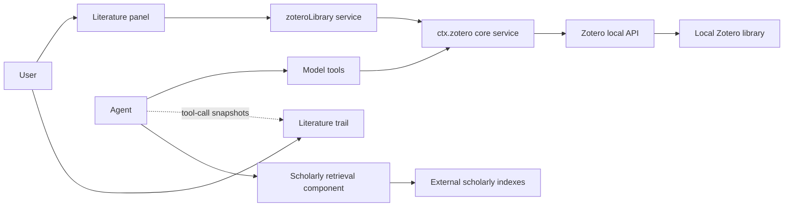

<a href="product-model.md"><b>中文</b></a>

# Product Model

dsh-zotero runs around the local Zotero library. The model uses tools, the human uses the interface, working together through two entry points and two views, backed by three decoupled components.

## Two Entry Points

The system provides independent entry points for the model and the user:

| Entry point        | User     | Interaction channel                             | Responsibilities                                                                                                     |
| :----------------- | :------- | :---------------------------------------------- | :------------------------------------------------------------------------------------------------------------------- |
| **Agent tools**    | AI model | Tool calls (Function Calling)                   | Search, read full texts, locate passages, and generate citations in conversation; modify the library under approval. |
| **User interface** | User     | Browser interface (right sidebar & session tab) | Browse the library, filter items, read PDFs, and copy citations; verify papers and passages queried by the agent.    |

### Non-Proxying Principle

The two paths operate independently and never proxy each other:

- **The interface never calls tools directly**: "Ask" and "Add to chat" in the panel only populate item details into the composer. Whether and how to send it is up to the user; the web interface has no channel to trigger model tools directly.
- **Tool calls never disrupt the interface**: When the agent calls tools in the background to search or read papers, it does not alter the selected item, collection tree state, or scroll position in the literature panel.

## Two Surfaces

The local Zotero desktop app is the single source of truth. The interface offers two views: one for finding literature, and one for checking what the agent did:

| Surface              | Location        | Role                                                                                                                                                                   | Data source                                       |
| :------------------- | :-------------- | :--------------------------------------------------------------------------------------------------------------------------------------------------------------------- | :------------------------------------------------ |
| **Literature panel** | Right sidebar   | **Global library view**: for manual browsing and citing. Navigate collection trees, tags, saved searches, and the Trash; inspect details and read PDFs.                | Local API (via `zoteroLibrary` service endpoints) |
| **Literature trail** | Session top tab | **Session audit view**: for verifying the agent's work. Lists queried papers, search parameters, extracted passages, and export records from the current conversation. | Tool-call snapshots from the current session      |

Their responsibilities do not overlap: the literature panel does not track what the agent did, and the literature trail does not offer library browsing or editing.

DSH's built-in "Trail" tab records tool-call execution times and raw parameters; the "Literature trail" focuses purely on literature, showing search conditions, source passages, and export records.

## Three Components

The plugin is split into three components with distinct roles:

| Component name             | Role                                                                | Default state | Partition rationale                                                                                             |
| :------------------------- | :------------------------------------------------------------------ | :------------ | :-------------------------------------------------------------------------------------------------------------- |
| **`dsh-zotero` (core)**    | Local communication, base model tools, literature trail, settings   | Enabled       | Plugin foundation, providing core connections and baseline capabilities.                                        |
| **`dsh-zotero/library`**   | Literature panel service (`zoteroLibrary`) and sidebar interface    | Enabled       | Decouples the library browsing UI so it can be disabled as a whole, with an independent settings namespace.     |
| **`dsh-zotero/scholarly`** | External scholarly retrieval, open-access full text, citation check | Disabled      | External network authorization boundary; outbound requests to academic indexes are permitted only when enabled. |

### Component Roles

- **Core component**: The plugin body. Manages communication with the local Zotero API (`127.0.0.1:23119`), registers 8 read tools and 15 write tools, and maintains the literature trail and configuration options.
- **Literature panel component**: Exposes read and write endpoints (`browse`, `search`, `item`, etc.) to the frontend. It registers no tools and injects no prompts; requests forward directly to the core service. It can be unmounted entirely if the sidebar is not needed.
- **Scholarly retrieval component**: The only component capable of accessing the external network. When unmounted, no outbound networking capability or tools exist in the host; when mounted, it registers 7 scholarly retrieval tools, strictly confined to allowlisted academic indexes.

## Data Flow

Both primary paths reach the local library through `ctx.zotero`. External scholarly retrieval is the only capability that leaves this machine, active only when the component is enabled.

## Four Boundaries

1. **Write safety**: Write tools are disabled by default. Once enabled, they may modify only the personal library (`zotero://user/0/`); every write (from the agent or the panel) requires approval and plan card confirmation, with no automatic retries on failure.
2. **Network isolation**: Local requests connect strictly to loopback addresses (`127.0.0.1`) without following redirects; external requests are issued only by the scholarly retrieval component, limited to allowlisted academic indexes.
3. **Trail scope**: The literature trail records only read tool calls and exports from this session; writes are recorded on approval cards and do not enter the trail; external papers found via scholarly search do not enter the trail until saved to the library.
4. **Scope limits**: The Trash is accessible only via the literature panel and is not exposed to model tool search scopes; panel searches cover only the local library, leaving external discovery to the agent via the scholarly component.

## Typical Workflows

- **Research and verify in chat**: Ask questions in chat → the agent queries the local library and extracts passages with page numbers → switch to the **literature trail** at the top to check search terms and original sources.
- **Browse and cite in the sidebar**: Open the **literature panel** in the right sidebar to browse collections or filter items, and read PDFs; copy BibTeX or CSL citations from the action row, or click "Ask" to send the item into the composer.
- **Find and save external literature**: Have the agent search external indexes and read open-access full text via the scholarly component; save selected papers to the personal library upon confirmation, after which they appear in both the panel and the trail.
