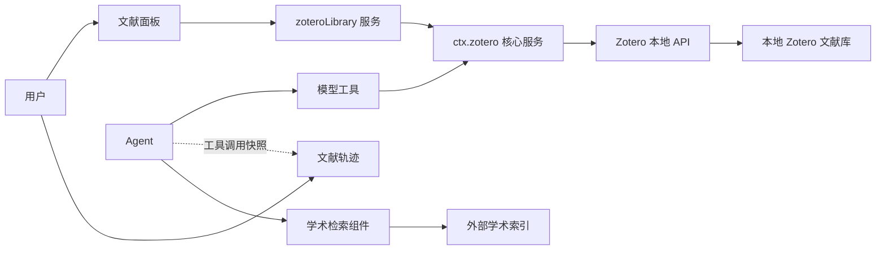

<a href="product-model.en.md"><b>English</b></a>

# 产品模型

dsh-zotero 围绕本机的 Zotero 文献库运行。模型走工具，人走界面，通过两个入口和两套视图分工协作，底层由三个组件支撑。

## 两个入口

系统为模型和用户提供独立的交互入口：

| 入口           | 使用者  | 交互方式                             | 职责                                                                        |
| :------------- | :------ | :----------------------------------- | :-------------------------------------------------------------------------- |
| **Agent 工具** | AI 模型 | 模型工具调用（Function Calling）     | 在对话中检索、阅读原文、定位出处片段、生成引用；经审批后修改文献库。        |
| **用户界面**   | 用户    | 浏览器界面（右侧面板与会话顶部标签） | 浏览整个文献库、筛选条目、阅读 PDF、复制引用；核对 Agent 调用的文献与出处。 |

### 互不代理原则

两条路径各司其职，互不代理：

- **界面不直接调用工具**：面板里的「提问」「加入对话」只负责把条目信息填入输入框，发不发送、怎么提问由用户决定；Web 界面没有直接触发模型工具的通道。
- **工具调用不干扰界面**：Agent 在后台调用工具检索或阅读文献，不会改变用户在文献面板中选中的条目、合集树展开状态或滚动位置。

## 两个视图

本地 Zotero 是唯一的数据源。界面上提供两个视图，一个用来找文献，一个用来核对 Agent 做过的事：

| 视图         | 位置           | 定位                                                                                                      | 数据来源                              |
| :----------- | :------------- | :-------------------------------------------------------------------------------------------------------- | :------------------------------------ |
| **文献面板** | 右侧边栏       | **全局库视图**：供用户查阅与取用。浏览合集树、标签、保存的搜索与回收站，查看条目详情并阅读 PDF。          | 本地 API（通过 `zoteroLibrary` 服务） |
| **文献轨迹** | 会话顶部标签页 | **会话核对视图**：供用户核对 Agent 的工作。列出当前会话中检索的文献、查询参数、提取的原文片段与导出记录。 | 本会话的工具调用快照                  |

两处互不重叠：文献面板不记录 Agent 做过的事，文献轨迹也不提供全库浏览与编辑。

DSH 自带的「系统轨迹」记录工具调用的耗时与原始参数；「文献轨迹」只关注文献本身，展示查询条件、原文片段与导出记录。

## 三个组件

插件拆分为三个职责不同的组件：

| 组件名称                   | 角色                                          | 默认状态 | 拆分原因                                                 |
| :------------------------- | :-------------------------------------------- | :------- | :------------------------------------------------------- |
| **`dsh-zotero`（核心）**   | 本地通信、基础模型工具、文献轨迹、设置页      | 启用     | 插件主体，提供底层连接与基础能力。                       |
| **`dsh-zotero/library`**   | 文献面板服务（`zoteroLibrary`）与右侧边栏界面 | 启用     | 将全库浏览界面独立拆出，支持整体关闭，并有独立的设置项。 |
| **`dsh-zotero/scholarly`** | 外部学术检索、开放获取全文读取、引文核验      | 关闭     | 外部网络授权边界，启用后才允许向白名单学术索引发请求。   |

### 组件分工

- **核心组件**：插件主体。管理与本地 Zotero API（`127.0.0.1:23119`）的通信，注册 8 个读取工具与 15 个写入工具，维护文献轨迹与配置项。
- **文献面板组件**：向前端提供只读与写入端点（`browse`、`search`、`item` 等），自身不注册工具，不注入提示词段，端点请求全部转交核心服务。不需要侧边栏时可以整体卸载。
- **学术检索组件**：唯一具备访问外网能力的组件。未启用时，宿主中不存在任何外网请求能力与对应工具；启用后注册 7 个学术检索工具，且请求严格限制在预设的白名单学术索引内。

## 数据流

两条主通路均通过 `ctx.zotero` 访问本地文献库。外部学术检索是唯一离开本机的能力，仅在组件启用时生效。

## 四条边界

1. **写入安全**：写入工具默认关闭。开启后只能修改个人库（`zotero://user/0/`）；无论来自 Agent 还是面板，每次写入都要经过审批和计划卡确认，失败不自动重试。
2. **网络隔离**：本地请求严格走环回地址（`127.0.0.1`），不跟随重定向；外部请求只由学术检索组件发出，且仅限白名单内的学术索引。
3. **轨迹范围**：文献轨迹只记录当前会话的读操作和导出；写入由审批卡记录，不进轨迹；外部检索到的文献在保存进库前，也不计入轨迹。
4. **作用域**：回收站只有面板能查看，模型工具不检索回收站；面板检索仅限于本地库，外部检索全部由 Agent 负责。

## 典型工作流

- **在对话中研读与核对**：在会话中向 Agent 提问，Agent 检索本地文献并提取带页码的原文片段；随后切到顶部的文献轨迹，核对查询条件与原文出处。
- **在侧边栏查阅与引用**：在右侧边栏打开文献面板，翻阅合集或筛选条目，阅读 PDF；动作行可直接复制 BibTeX 或 CSL 引用，也可以点「提问」把文献填入会话输入框。
- **查找与保存库外文献**：让 Agent 通过学术检索组件搜索外部索引、阅读开放获取全文；确认需要后保存到本地个人库，随后该文献即可在面板和轨迹中查看。
